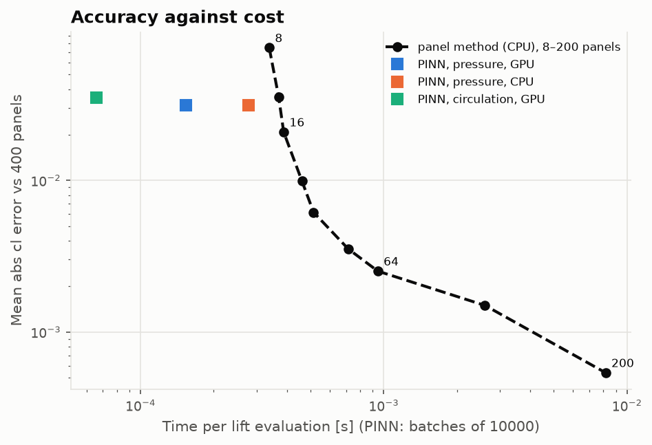
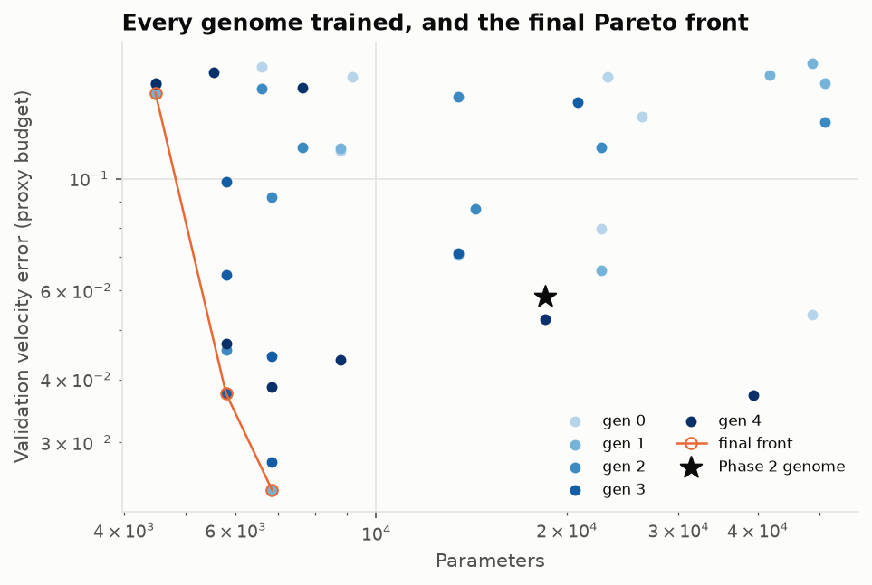
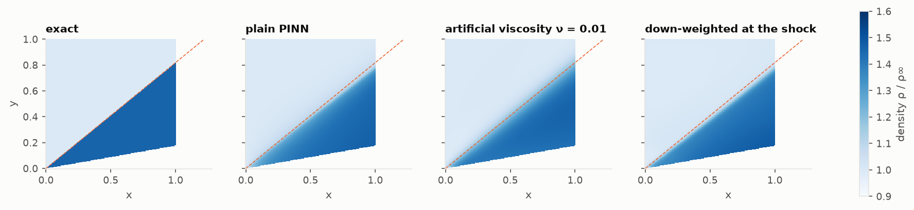

# PINN-CFD aerodynamics

[](https://github.com/GMCavalheri/pinn-cfd-aerodynamics/actions/workflows/ci.yml)

Physics-informed neural networks (PINNs) for aerodynamic flows, tested against exact solutions
and a classical panel method:
- potential flow past a cylinder;
- one network for the whole NACA 4-digit family at any incidence;
- a neuroevolutionary search over the network's architecture and loss weights;
- a surrogate benchmark in a design loop;
- an exploratory steady Euler solver, with a shock it cannot capture.

Every training run records its error, training time and steps to converge, and every failure
is reported with its evidence.

<p align="center">
  
  
  
</p>

## What's inside

| Module | Method | Validated against |
|---|---|---|
| [`pinn_laplace_2d`](src/pinncfd/pinn_laplace_2d) | stream-function PINN, soft and hard (distance-function) boundary conditions, with and without circulation | exact cylinder flow; AERO-01 panel method |
| [`pinn_airfoil_flowfield`](src/pinncfd/pinn_airfoil_flowfield) | $\psi(x, y; m, p, t, \alpha)$ for a NACA 4-digit family, inverse-Joukowski input features, Kutta/tangency/far-field losses, sparse panel data | AERO-01 panel method on held-out sections |
| [`neuroevolution_search`](src/pinncfd/neuroevolution_search) | NSGA-II over depth, width, activation, Fourier features, learning rate, collocation and five loss weights | Deb et al. (2002) fronts; the hand-tuned network on the test set |
| [`surrogate`](src/pinncfd/surrogate.py) | batched lift, Newton on the incidence with autograd derivatives, break-even cost model | panel method at 200 panels and at equal accuracy |
| [`pinn_euler_2d`](src/pinncfd/pinn_euler_2d) (exploratory) | conservation-form Euler residuals, positive density and pressure, artificial viscosity | Ringleb flow (exact); oblique shock (θ–β–M, NACA Report 1135) |

The panel method is [AERO-01, Aerodynamics From Scratch](https://github.com/GMCavalheri/aerodynamics-from-scratch),
a pinned git dependency imported only in [`src/pinncfd/external/`](src/pinncfd/external).

## Headline results

| Benchmark | PINN | Reference |
|---|---|---|
| Cylinder, velocity error, hard constraints | 7.7e-5 (1e-2 reached in 400–500 steps, 10–13 s) | soft constraints: 1.2e-3, 5600 steps; 512 panels: 9.3e-4 |
| NACA family, test velocity error (6 sections × 4 angles) | 1.16 % (hand-tuned); **0.78 %** (evolved, a third of the parameters) | 400-panel solutions |
| Lift error, 500 random sections | 0.031 | 200 panels: 0.0005; 16 panels: 0.021 |
| 10⁴ lift evaluations | 1.54 s (GPU) | 200 panels: 80 s; 16 panels: 3.9 s |
| Break-even, training charged | 84,000 evaluations | 2.8 million against the equal-accuracy 16-panel solver |
| Incidence for cl = 0.8, six sections | 4 Newton steps, 0.064 s, 0.05–0.41° off | Brent on 200 panels: 0.27 s |
| Ringleb flow (smooth, transonic), state error | 0.14 % | exact |
| Mach 2 wedge, shock angle | 36.9–38.4°, shock smeared over 0.13–0.17 | 39.31° exact, sharp |

Compute budget for every run (RTX 2060 at 1000 MHz): **[comparison report](docs/comparison-report.md)**,
and the raw record in [`validation/results/compute_budget.csv`](validation/results/compute_budget.csv)
([column guide](validation/results/README.md)).

## Quickstart

Requires [uv](https://docs.astral.sh/uv/). PyTorch comes from the PyTorch indexes, as an extra:

```bash
uv sync --extra cpu
uv run pytest
```

or `uv sync --extra cu132` for CUDA 13.2 wheels (they include Turing GPUs such as the RTX 2060).

```python
import numpy as np

from pinncfd import io
from pinncfd.pinn_airfoil_flowfield import AirfoilPINN
from pinncfd.surrogate import cl_pressure, solve_alpha

# the Phase 3 champion: one network for every NACA 4-digit section in the family box
model, _ = io.load_checkpoint(
    "validation/results/checkpoints/phase3_champion_s0.pt", AirfoilPINN, "cpu"
)

# rows (m, p, t, alpha): NACA 2412 and 4415 at 4 degrees, in one batched call
q = np.array([[0.02, 0.4, 0.12, np.radians(4)], [0.04, 0.4, 0.15, np.radians(4)]])
print(cl_pressure(model, q, "cpu").round(3))  # [0.722 0.998]; panel method: 0.743, 1.029

# the incidence for cl = 0.8, by Newton with d cl / d alpha from autograd
alpha, cl, n_eval = solve_alpha(model, q, 0.8, "cpu")
print(np.degrees(alpha).round(2), n_eval)  # [4.66 2.32] 3
```

Retrain everything (about 4–5 GPU-hours), smoke-test every script (3 minutes), or redraw the
figures from the saved results:

```bash
uv run python validation/run_all.py
```

```bash
uv run python validation/run_all.py --quick
```

```bash
uv run python validation/run_all.py --plots-only
```

Rebuild the executed notebooks (byte-identical on the same machine):

```bash
uv run python notebooks/build_notebooks.py
```

## Repository layout

```
src/pinncfd/         shared core (nn, autodiff, sampling, training, io) + one subpackage per phase
src/pinncfd/external the only importer of AERO-01's panel method
tests/               pytest: closed-form and cited checks, short seeded training runs
validation/          one script per phase; results/ (tables, checkpoints, compute budget)
notebooks/           executed walkthroughs, one per lesson (generated by build_notebooks.py)
docs/                theory notes, comparison report, figures, lessons/ (the course)
```

## Course

A six-lesson course walks through every phase, with derivations, the failed attempts, figures,
pitfalls and exercises: **[start here](docs/lessons/README.md)**.

1. [Physics-informed neural networks for potential flow](docs/lessons/01-pinns-for-potential-flow.md)
2. [Learning a family of airfoil flow fields](docs/lessons/02-airfoil-flow-fields.md)
3. [Neuroevolution for PINN architecture and loss weighting](docs/lessons/03-neuroevolution.md)
4. [PINNs as surrogates in a design loop](docs/lessons/04-surrogates-in-a-design-loop.md)
5. [Toward compressible flow, and where PINNs struggle](docs/lessons/05-toward-compressible-flow.md)
6. [Verification, validation, and when to use a PINN](docs/lessons/06-verification-validation-and-when-to-use-a-pinn.md)

## Theory notes

1. [Training and the compute-budget record](docs/training.md)
2. [PINN for potential flow past a cylinder](docs/pinn_laplace_2d.md)
3. [PINN for a family of airfoil flow fields](docs/pinn_airfoil_flowfield.md)
4. [Neuroevolutionary search](docs/neuroevolution_search.md)
5. [The PINN as a surrogate](docs/surrogate.md)
6. [PINNs for the steady Euler equations](docs/pinn_euler_2d.md)

## Conventions

Nondimensional throughout: cylinder radius 1 or chord 1, freestream speed 1. Angles in radians.
Potential flow is solved for the stream function, which stays single-valued with circulation.
Training uses float32; exact solutions and error metrics use float64. See
[CLAUDE.md](CLAUDE.md) for contributor conventions.

## Scope and limits

- Incompressible potential flow and steady inviscid compressible flow only: no viscosity, no
  separation, no turbulence.
- The airfoil network covers $m \le 0.06$, $0.3 \le p \le 0.5$, $0.08 \le t \le 0.18$ and
  $-4° \le \alpha \le 8°$. Outside that box it extrapolates, with lift errors up to 0.37.
- Its circulation-based lift slope is low: about 20 % for the hand-tuned network, less for the
  evolved one. Its Cp is least accurate at the trailing edge.
- The Euler PINN does not capture shocks. That is documented in Lesson 5, not hidden.
- The surrogate's advantage over a panel method is small at equal accuracy. The case for PINN
  surrogates is expensive solvers, which this project did not test.

## License

[MIT](LICENSE)
