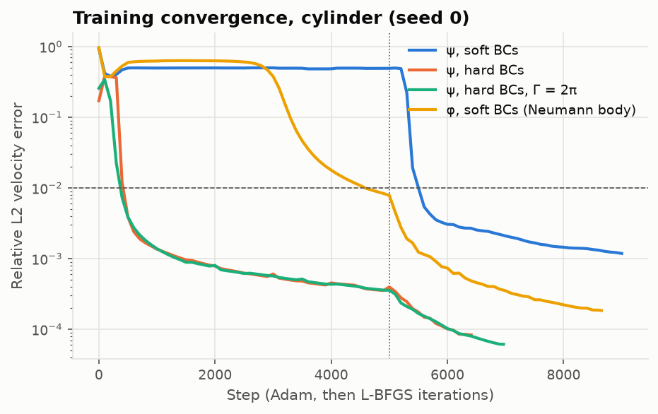
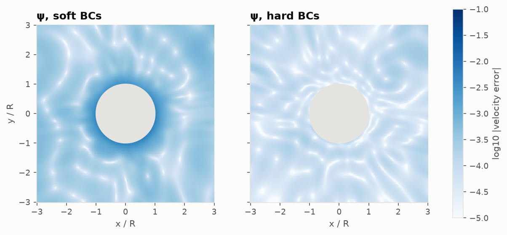
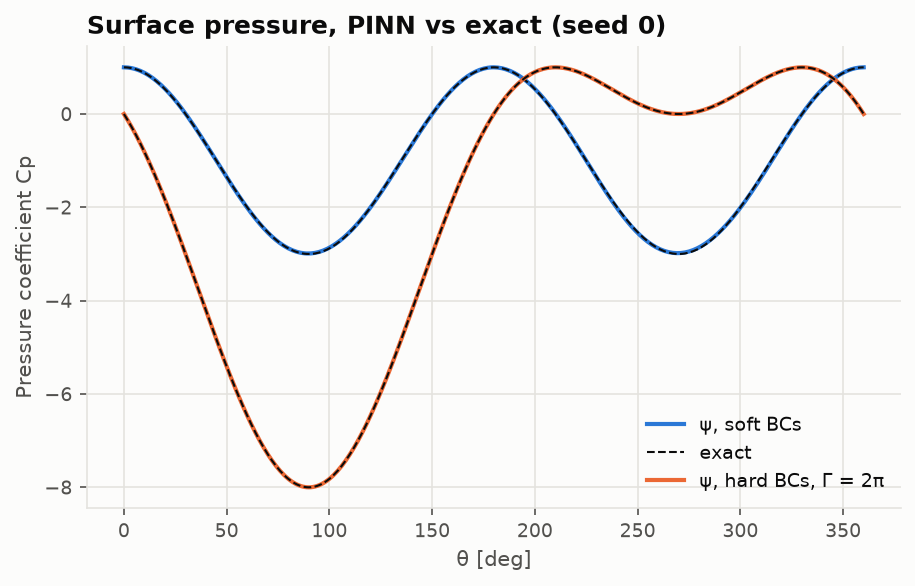
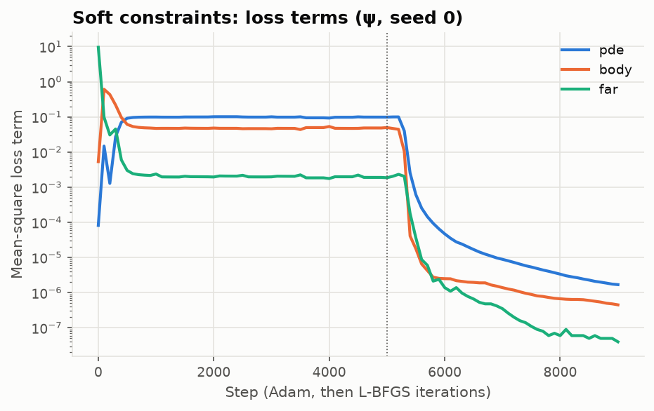

# Lesson 1 · Physics-informed neural networks for potential flow

> A panel method writes the flow as a sum of singularities and solves a linear system for their
> strengths. A physics-informed neural network (PINN) writes it as a neural network and trains
> the weights until the governing equation holds. This lesson builds the simplest PINN that
> means anything in aerodynamics, potential flow past a cylinder, and checks it against the
> exact solution. Along the way we see the most important practical lesson about PINNs: *how*
> you impose the boundary conditions matters more than how big the network is.

**Code:** [`src/pinncfd/pinn_laplace_2d/cylinder.py`](../../src/pinncfd/pinn_laplace_2d/cylinder.py),
[`src/pinncfd/training.py`](../../src/pinncfd/training.py),
[`src/pinncfd/autodiff.py`](../../src/pinncfd/autodiff.py) ·
**Results:** [`validation/results/laplace_cylinder.md`](../../validation/results/laplace_cylinder.md) ·
**Notebook:** [`01_laplace_cylinder.ipynb`](../../notebooks/01_laplace_cylinder.ipynb) ·
**Next:** [Lesson 2](02-airfoil-flow-fields.md)

## Learning objectives

1. Turn a boundary-value problem into a loss function a network can minimise.
2. Explain why this project solves for the stream function rather than the velocity potential.
3. Compute PDE residuals exactly with automatic differentiation.
4. Impose boundary conditions softly (as penalties) or exactly (with a trial-function ansatz),
   and predict which one trains better.
5. Read a convergence history: steps to a target error, the plateau, and what Adam and L-BFGS
   each contribute.

---

## 1. The idea in one paragraph

A neural network $\psi_\theta(x, y)$ with weights $\theta$ is a smooth function of its inputs,
and we can differentiate it with respect to them exactly. If $\psi$ must satisfy
$\nabla^2\psi = 0$ in a domain $\Omega$ with $\psi = g$ on its boundary, then

```math
\mathcal L(\theta) =
\frac{\lambda_r}{N_r}\sum_{i=1}^{N_r}\left(\nabla^2\psi_\theta(\mathbf x_i)\right)^2
+ \frac{\lambda_b}{N_b}\sum_{j=1}^{N_b}\left(\psi_\theta(\mathbf x_j) - g(\mathbf x_j)\right)^2
```

is zero exactly when the network solves the problem at the **collocation points**
$\mathbf x_i \in \Omega$ and $\mathbf x_j \in \partial\Omega$. Minimise it with a gradient
optimiser and you have a PINN (Lagaris et al. 1998; Raissi, Perdikaris & Karniadakis 2019).
There is no mesh, no linear system, no discretisation of derivatives — and no guarantee that the
optimiser finds the minimum. Everything that follows is about that last point.

## 2. The test problem: the cylinder

Uniform flow of speed $V_\infty = 1$ past a cylinder of radius $R = 1$, with or without a
clockwise circulation $\Gamma$, has a closed-form solution (Anderson, *Fundamentals of
Aerodynamics*, Secs. 3.12–3.15):

```math
\psi = y\left(1 - \frac{1}{r^2}\right) + \frac{\Gamma}{2\pi}\ln r,
\qquad u = \frac{\partial\psi}{\partial y},\quad v = -\frac{\partial\psi}{\partial x},
```

```math
C_p(\theta) = 1 - \left(2\sin\theta + \frac{\Gamma}{2\pi}\right)^2,
\qquad c_l = \frac{\Gamma}{V_\infty R}\ \text{(referred to the diameter)} .
```

We solve on the annulus $1 \le r \le 5$, with the exact $\psi$ prescribed on $r = 5$. That is a
deliberate choice for a *verification* case: the only error left is the network's, not the
truncation of an infinite domain (which returns with the airfoils in Lesson 2).

### Why the stream function?

Potential flow can be written for the velocity potential $\phi$ ($\mathbf V = \nabla\phi$) or the
stream function $\psi$. Both satisfy Laplace's equation. The difference is what happens with
circulation: going once around the body, $\phi$ changes by $\Gamma$, so a lifting flow has a
**multivalued** potential that needs a branch cut. A neural network is a single-valued smooth
function, so it cannot represent that without extra machinery. The stream function stays single
valued — circulation only adds the $\ln r$ term — and the body is simply the streamline
$\psi = 0$. The project therefore works with $\psi$ throughout; Section 4 still trains a $\phi$
network on the non-lifting cylinder, because its Neumann body condition makes an instructive
comparison.

## 3. Derivatives without a mesh

The Laplacian of the network output is computed by reverse-mode automatic differentiation
([`autodiff.py`](../../src/pinncfd/autodiff.py)): one backward pass gives
$\nabla\psi$, one more pass per input gives the second derivatives, and `create_graph=True`
keeps the result differentiable with respect to the weights so the optimiser can use it. These
are the network's *exact* derivatives, not finite differences: there is no truncation error in
the residual, only in how well the network approximates the solution.

Two consequences:

- The activation must be smooth. The residual contains $\partial^2\psi/\partial x^2$, and a ReLU
  network has zero second derivative almost everywhere. The networks here use $\tanh$.
- The tests check the machinery on functions whose Laplacian is known —
  $x^2 - y^2$, $e^x\sin y$ and $\ln r^2$ give zero to $10^{-12}$
  ([`tests/test_core.py`](../../tests/test_core.py)) — and check that the exact cylinder
  $\psi$ is harmonic and reproduces the analytic velocity
  ([`tests/test_laplace_cylinder.py`](../../tests/test_laplace_cylinder.py)).

The collocation points are redrawn every 500 steps, half area-uniform in the annulus and half
clustered against the body, where the velocity changes fastest
([`sampling.py`](../../src/pinncfd/sampling.py)).

## 4. Soft and hard boundary conditions

**Soft** constraints put the boundary conditions in the loss, as in Section 1. The network can
trade a small boundary error for a smaller residual, and the relative weights $\lambda$ decide
how.

**Hard** constraints build the boundary conditions into the output. With
$d(r) = (r - 1)(R - r)/((R - 1)/2)^2$, which vanishes on both circles, and
$\psi_R(\theta)$ the outer data,

```math
\psi(x, y) = \psi_R(\theta)\,\frac{r - 1}{R - 1} + d(r)\,N_\theta(x, y)
```

equals $0$ on the body and $\psi_R$ on the outer circle *whatever the network* $N_\theta$
outputs. Only the residual term is left in the loss (Lagaris et al. 1998; Sukumar & Srivastava
2022). The test `test_hard_constraint_ansatz_satisfies_the_boundary_conditions` checks this with
an untrained network.

The four runs:

| Case | Unknown | Body condition | Outer condition |
|---|---|---|---|
| ψ, soft | $\psi$ | $\psi = 0$, penalised | $\psi = \psi_R$, penalised |
| ψ, hard | $\psi$ | exact (ansatz) | exact (ansatz) |
| ψ, hard, $\Gamma = 2\pi$ | $\psi$ | exact (ansatz) | exact (ansatz) |
| φ, soft | $\phi$ | $\partial\phi/\partial n = 0$, penalised | $\phi = \phi_R$, penalised |

Same network for all: 4 hidden layers of 50 $\tanh$ units (7,851 weights), 8,192 interior
points, all loss weights 1. $\Gamma = 2\pi$ puts the stagnation points at $\theta = -30°$ and
$-150°$ and gives $c_l = 2\pi$.

## 5. Training: Adam, then L-BFGS

[`training.py`](../../src/pinncfd/training.py) runs 5,000 Adam steps (learning rate
$10^{-3}$ decaying to $10^{-4}$), then up to 4,000 L-BFGS iterations with a strong-Wolfe line
search on the last set of points. Adam is robust far from a minimum; L-BFGS uses curvature and
converges much faster once the loss is locally smooth and nearly quadratic. Every 100 steps the
loop evaluates the **velocity error** — the relative L2 norm of $(u, v)$ against the exact
solution on a $64\times128$ polar grid — so each run reports:

- **steps to target**: the first step with error $\le 10^{-2}$ (and $10^{-1}$, $10^{-3}$);
- **plateau step**: the first step after which the best error never improves by more than 1 %
  over a 500-step window;
- wall-clock time per stage, on an RTX 2060 capped at 1,000 MHz, excluding evaluation.

Steps are counted globally: Adam steps 1–5,000, then L-BFGS iterations from 5,001.

## 6. Results



Mean ± standard deviation over three seeds
([full table](../../validation/results/laplace_cylinder.md)):

| Case | Velocity error | max abs ΔCp | Steps to 1e-2 | Steps to 1e-3 | Plateau step | Adam + L-BFGS time |
|---|---|---|---|---|---|---|
| ψ, soft | 1.19e-3 ± 1.5e-4 | 0.024 | 5,600–5,700 | never | 8,800–9,000 | 71 + 97 s |
| ψ, hard | **7.7e-5** ± 6e-6 | 4.4e-4 | **400–500** | 1,300–1,500 | 6,400–6,700 | 123 + 60 s |
| ψ, hard, Γ = 2π | **6.7e-5** ± 9e-6 | 4.9e-4 | 300–400 | 1,000–1,400 | 6,500–7,267 | 121 + 73 s |
| φ, soft | 1.9e-4 ± 8e-6 | 1.7e-3 | 4,600–5,100 | 5,700–5,800 | 8,650–9,000 | 77 + 100 s |

The lifting network recovers $c_l = 6.2834 \pm 0.0002$ by integrating its surface pressure
(exact: $2\pi = 6.2832$).

What the table says:

- **Hard constraints win by an order of magnitude in error and in steps.** They reach 1 %
  error in 400–500 steps (13 s) where the soft $\psi$ network needs 5,600 (83 s). A hard
  step costs about 1.8 times a soft one (25 ms against 14 ms: the ansatz adds operations to
  every second derivative), and it is still far cheaper overall.
- **Circulation costs nothing.** With $\psi$, the lifting case is as easy as the non-lifting
  one; this is the payoff of Section 2's choice.
- **L-BFGS finishes the job.** For the hard cases it stops on its own tolerance after
  1,400–2,300 iterations, having cut the error by another factor of about 5.



The error maps show *where* the soft network is wrong: next to the body, the very place an
aerodynamicist cares about. Its body condition is only satisfied approximately, so the
streamline that should be the surface is slightly displaced and the surface speeds are off.
Its maximum surface $C_p$ error is 0.024, against $4\times10^{-4}$ for the hard network:



### Why soft ψ stalls under Adam

The soft $\psi$ network sits at about 50 % error for the *entire* Adam stage and only escapes
when L-BFGS starts. Its loss terms show why:



At initialisation the outer-boundary term dominates by four orders of magnitude, because
$\psi_R$ is of order $R = 5$. Adam quickly fits it, and the three terms then lock into a
compromise — residual $\approx 0.1$, body $\approx 0.05$, outer $\approx 0.002$ — where reducing
any one of them increases another. This imbalance between loss terms, whose gradients differ by
orders of magnitude, is the best-documented failure mode of PINNs (Wang, Teng & Perdikaris 2021).
L-BFGS's curvature information finds the way out; adaptive loss weights would be another. Hard
constraints remove the problem at the source: with only one term in the loss there is nothing
to balance. Phase 3 of this project hands exactly this balancing problem, for the airfoil
family, to a neuroevolutionary search.

The $\phi$ network has the same structure but escapes earlier (around step 3,000): its outer
data has the same magnitude, but its body condition is a derivative condition, whose gradient
scales differently.

## 7. And the panel method?

AERO-01's panel method reproduces the exact surface $C_p$ on a polygon to round-off at its
control points (non-lifting) and solves the cylinder in milliseconds. Its *field* velocity, on
the same grid restricted to $r \ge 1.05$, converges at first order: 0.0069, 0.0036, 0.0018,
0.0009 for 64–512 panels. On that subset the hard-constraint PINN's error is $8.5\times10^{-5}$,
ten times smaller than 512 panels, because the network represents a smooth field everywhere
while the panel field carries the polygonal geometry with it.

That is not a reason to prefer a PINN for one cylinder: 3 minutes of GPU training against
50 ms of CPU solve. The cost comparison only becomes interesting when one network replaces many
solves, which is where Lessons 2 and 4 go.

## 8. Compute budget

| Case | Error (velocity, relative L2) | Training time | Steps to 1e-2 | Plateau |
|---|---|---|---|---|
| ψ, hard | 7.7e-5 | 183 s (123 Adam + 60 L-BFGS) | 400–500 (≈ 13 s) | 6,400–6,700 |
| ψ, hard, Γ = 2π | 6.7e-5 | 194 s | 300–400 (≈ 10 s) | 6,500–7,267 |
| φ, soft | 1.9e-4 | 177 s | 4,600–5,100 (≈ 71 s) | 8,650–9,000 |
| ψ, soft | 1.2e-3 | 168 s | 5,600–5,700 (≈ 83 s) | 8,800–9,000 |

Every run is a row of
[`validation/results/compute_budget.csv`](../../validation/results/compute_budget.csv) with its
seed, device, library versions and commit.

## 9. Common pitfalls

- **ReLU.** Its second derivative is zero almost everywhere; the residual cannot see it.
- **Unscaled inputs.** The network sees $(x, y)/5$ so its first layer works in $[-1, 1]$.
- **Judging by the loss.** The soft network's loss at step 5,000 looks small ($\sim 0.1$) and
  its error is 50 %. Always track an error against a reference while developing.
- **Comparing step counts across optimisers.** An L-BFGS iteration costs one to several loss
  evaluations; compare wall time as well as steps.
- **Bit-for-bit reproducibility on GPU.** CUDA kernels are not deterministic; report seeds and
  spreads, as the tables do.

## 10. Exercises

1. Show that $\psi = y(1 - 1/r^2)$ is harmonic, and that $\psi = 0$ on $r = 1$.
2. For the soft $\psi$ network, multiply the body weight by 100. Predict the effect on the Adam
   stage, then run it (`CylinderProblem(..., weights={"body": 100})`).
3. Why does the hard ansatz divide $d(r)$ by $((R - 1)/2)^2$?
4. Explain why a $\phi$ network cannot represent the lifting cylinder, even approximately, with
   any amount of training.
5. The panel method's field error halves each time $N$ doubles. How many panels would it need to
   match the hard PINN's $8.5\times10^{-5}$ on $r \ge 1.05$, and how long would that solve take
   if the cost grows as $N^2$?

<details>
<summary>Answers</summary>

1. In polar form $\psi = (r - 1/r)\sin\theta$; $\nabla^2(r^n\sin\theta) = (n^2 - 1)r^{n-2}\sin\theta$,
   which vanishes for $n = \pm1$. At $r = 1$, $r - 1/r = 0$.
2. Measured (seed 0, same budget): it gets *worse*. Adam drives the body term to $10^{-5}$
   but the residual stays at 0.21 and the velocity error at 0.60 for all 5,000 steps; L-BFGS
   then stops on its tolerance after 194 iterations, still at 61 % error. Raising one weight
   moves the compromise; it does not remove the imbalance. Choosing weights well is a search
   problem, which is what Lesson 3 hands to evolution.
3. So that $d \le 1$, with its maximum 1 at mid-annulus: the network output then has the same
   scale as $\psi$ instead of being multiplied by a factor up to 4.
4. $\phi$ must change by $\Gamma$ around any loop enclosing the body; a continuous single-valued
   function changes by zero. The best a network can do is put a steep jump somewhere, which
   violates Laplace's equation there.
5. About $512 \times 0.00093/0.000085 \approx 5{,}600$ panels; the solve would take
   $53\ \text{ms} \times (5600/512)^2 \approx 6$ s, still faster than training the network.

</details>

## Key takeaways

- A PINN is a network plus a loss built from the governing equation and boundary conditions;
  automatic differentiation gives exact residuals.
- Use the stream function for lifting potential flow: it stays single valued.
- Hard (ansatz) boundary conditions removed both the error floor and the training stall:
  $7.7\times10^{-5}$ in 183 s against $1.2\times10^{-3}$ in 168 s, and 1 % in 13 s.
- Soft constraints fail through loss imbalance, not lack of capacity. Watch the error, not just
  the loss.
- For one smooth geometry a PINN can be more accurate than a panel method but is orders of
  magnitude more expensive. Lesson 2 trains one network for a whole family of airfoils.

## Further reading

- I. E. Lagaris, A. Likas & D. I. Fotiadis, "Artificial neural networks for solving ordinary
  and partial differential equations", *IEEE Trans. Neural Networks* 9, 1998.
- M. Raissi, P. Perdikaris & G. E. Karniadakis, "Physics-informed neural networks", *J. Comput.
  Phys.* 378, 2019.
- S. Wang, Y. Teng & P. Perdikaris, "Understanding and mitigating gradient flow pathologies in
  physics-informed neural networks", *SIAM J. Sci. Comput.* 43, 2021.
- N. Sukumar & A. Srivastava, "Exact imposition of boundary conditions with distance functions
  in physics-informed deep neural networks", *Comput. Methods Appl. Mech. Eng.* 389, 2022.
- J. D. Anderson, *Fundamentals of Aerodynamics*, Ch. 3.
