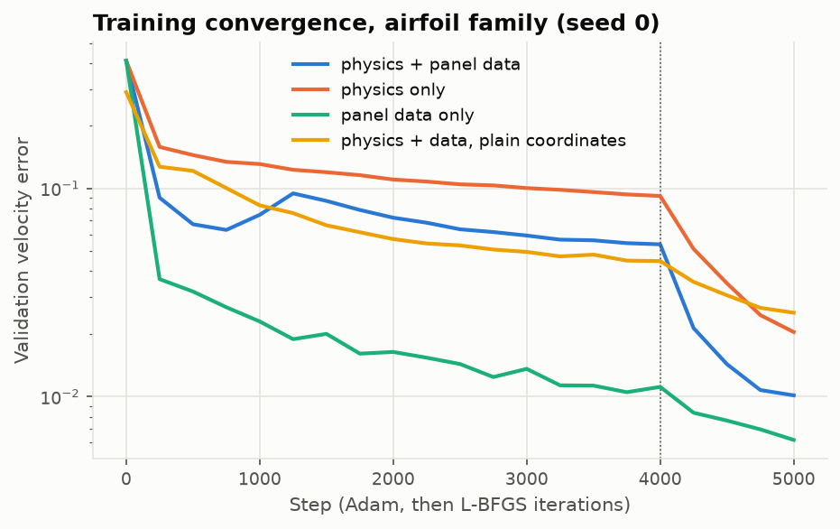
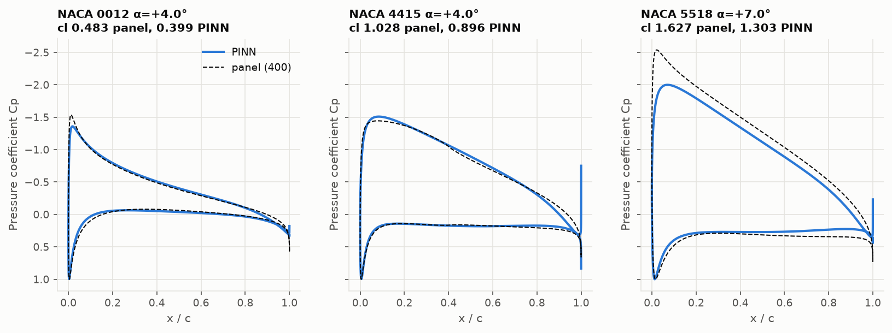
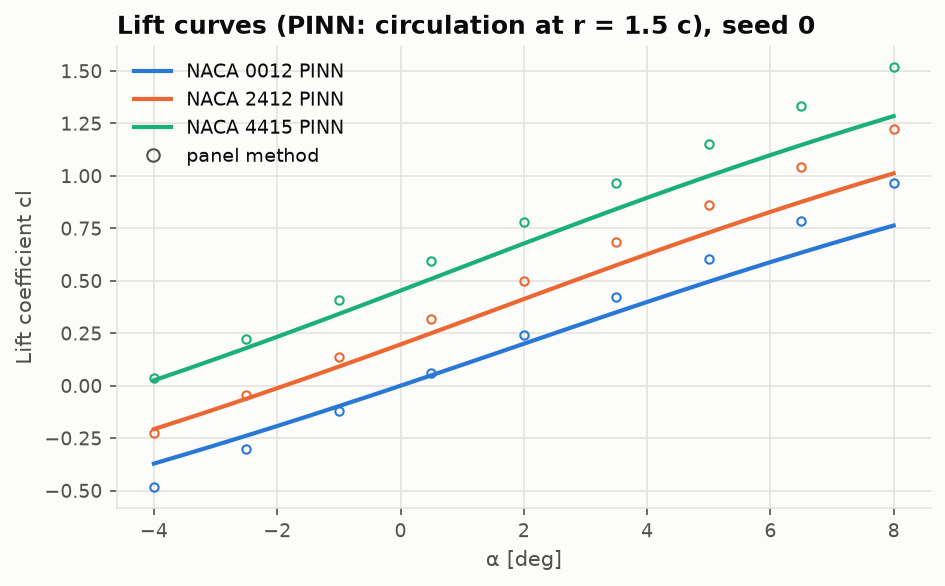
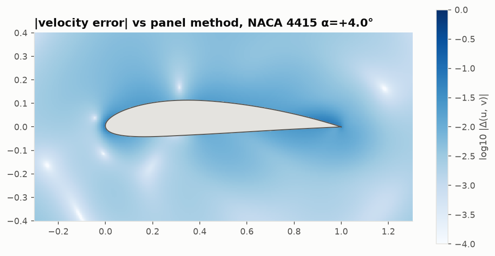

# Lesson 2 · Learning a family of airfoil flow fields

> Lesson 1 trained one network for one cylinder. Here one network learns the flow around *every*
> NACA 4-digit section in a box of camber, camber position, thickness and incidence — and the
> first nine attempts fail. The failures are the lesson: each one is a way a smooth network
> can satisfy a loss without solving the problem, and the cure for the worst of them comes not
> from machine learning but from a 1910 conformal map.

**Code:** [`src/pinncfd/pinn_airfoil_flowfield/`](../../src/pinncfd/pinn_airfoil_flowfield/) ·
**Results:** [`validation/results/airfoil_flowfield.md`](../../validation/results/airfoil_flowfield.md) ·
**Notebook:** [`02_airfoil_family.ipynb`](../../notebooks/02_airfoil_family.ipynb) ·
**Previous:** [Lesson 1](01-pinns-for-potential-flow.md) · **Next:** [Lesson 3](03-neuroevolution.md)

## Learning objectives

1. Turn a PINN into a *parametric* solver whose inputs include the geometry and the incidence.
2. Impose the Kutta condition and the far field so that a smooth network cannot cheat them.
3. Recognise four failure modes — no circulation, leakage, a hidden far-field doublet and a
   slowed-down flow — from their symptoms.
4. Use the inverse Joukowski map as input coordinates, and explain why it fixes what loss
   weighting could not.
5. Measure lift from a predicted field, and validate against a panel method on held-out shapes.

---

## 1. One network for a family

The PINN now takes six inputs, $\psi(x, y; m, p, t, \alpha)$: position, the three NACA 4-digit
parameters (maximum camber $m$, its position $p$, thickness $t$; Abbott & von Doenhoff, Sec. 6.4)
and the angle of attack. The family is the box

| $m$ | $p$ | $t$ | $\alpha$ |
|---|---|---|---|
| 0–0.06 | 0.3–0.5 | 0.08–0.18 | −4° to 8° |

and every Adam step draws 32 fresh $(m, p, t, \alpha)$ anywhere in it for the physics terms:
physics costs no data, so the network can be asked to obey Laplace's equation for shapes nobody
has ever solved. Panel-method data from AERO-01 (400 panels) enters only at 40 *training* cases
(a Latin hypercube; McKay, Beckman & Conover 1979). Eight *validation* cases monitor training,
and the *test* set — NACA 0012, 1408, 2412, 3315, 4415 and 5518, each at −3°, 1°, 4° and 7° — is
evaluated once, at the end.

## 2. The formulation

As in Lesson 1, the unknown is the stream function. It is split into a known part and a learned
disturbance:

```math
\psi = y\cos\alpha - x\sin\alpha + \frac{\Gamma(q)}{2\pi}\ln\frac{|w|}{R} + \psi'(x, y; q),
\qquad q = (m, p, t, \alpha),
```

where the second term is a vortex of clockwise circulation $\Gamma$ "inside the section"
($w$ and $R$ are defined in Section 4; far away $\ln|w| \to \ln r$). The disturbance $\psi'$
decays like a doublet, so the network only has to learn something of the size of the thickness.
A small second network gives $\Gamma$ and the body's streamline value $\psi_b$ as functions of
$q$ alone.

The loss has six terms ([`problem.py`](../../src/pinncfd/pinn_airfoil_flowfield/problem.py)):

| Term | Condition | Where |
|---|---|---|
| `pde` | $\nabla^2\psi' = 0$, residual scaled by $\min(1, (d/0.1c)^2)$ | interior points |
| `body` | $\psi = \psi_b$ | surface |
| `tangency` | $\mathbf V\cdot\mathbf n = 0$ | surface |
| `kutta` | equal *downstream* tangential velocity, upper and lower surface | $x = 0.97, 0.985$ |
| `far` | $\psi'^2 + (r\ \partial\psi'/\partial r)^2 = 0$ | $r = 8c$ |
| `data` | velocity misfit to the panel solution | 40 training cases |

Every line in that table except `pde`, `body` and `data` is there because of a failure.

## 3. Eleven ways to be wrong

The debugging was done on a single section, NACA 2412 at 4° (panel $c_l = 0.742$), training on
physics alone for about 2,000 Adam steps and a few hundred L-BFGS iterations. Each row is a
measured run; "field error" is the relative L2 velocity error against the panel solution.
Changes accumulate down the table, except rows 3, 4, 8 and 9, which were tried and reverted.

| # | Change | Field error | $c_l$ | What the network did |
|---|---|---|---|---|
| 1 | Kutta as equal *speeds*, $\psi = \psi_b$ only, Robin far field, plain coordinates | 0.61 | ≈ 0.05 | no circulation |
| 2 | Kutta as equal *downstream* velocities | 0.60 | ≈ 0.07 | still none |
| 3 | body and Kutta weights raised to 1,000 | 0.78 | ≈ 0 | conditions met, Laplace violated |
| 4 | exact body condition via an approximate distance function | 0.79 | ≈ 0 | residual dominated by the ADF's curvature |
| 5 | + surface-tangency term | 0.90 | ≈ 0 | flow slowed to $u \approx 0.45$ near the body |
| 6 | Dirichlet far field, log-radial sampling | 0.75 | ≈ 0 | flow slowed to $u \approx 0.28$ |
| 7 | + dense panel data | 0.12 | 0.31 | data and physics in conflict |
| 8 | residual scaled by $(d/0.1c)^2$ | 0.77 | ≈ 0 | unchanged |
| 9 | PDE weight × 100 | 0.15 | ≈ 0.1 | harmonic, but the body ignored |
| 10 | **inverse-Joukowski input coordinates** | **0.020** | — | right flow; circulation split oddly |
| 11 | + $(r\ \partial\psi'/\partial r)^2$ in the far field | **0.0097** | 0.68 | right flow, right circulation |

What each failure teaches:

- **Rows 1–2: the circulation-free flow satisfies a weak Kutta condition.** Lift comes from
  circulation, and circulation is fixed only by the Kutta condition. Equal *speeds* above and
  below the trailing edge is also true of the zero-circulation flow, which runs downstream on
  one side and upstream on the other; AERO-01's panel method uses the directional form for
  exactly this reason. But even the directional form was met trivially, because…
- **Rows 3–5: a soft streamline condition leaks.** $\psi = \psi_b$ charges a leak through the
  surface by the flux $Q$ it carries. With a body loss of $10^{-3}$ (a $\psi$ error of 0.03)
  the freestream can pass straight through the 0.5 %-thick tail, and a flow that passes through
  the tail needs no circulation at all. Penalising the normal velocity charges the leak speed
  $Q/\ell$ instead, where $\ell$ is the length of surface it crosses: a leak through a short
  stretch of tail is cheap in $\psi$ and expensive in velocity.
- **Rows 5–6: a far-field condition can hide a lie.** The network then learned a *slower*
  freestream near the body: every near-body condition is unchanged when the flow is scaled down,
  while the residual left by an imperfect fit near the leading edge shrinks with the speed. It
  paid for the slowdown with a shell of residual a few chords out — like a vortex sheet around a
  cylinder — and the Robin condition $r\ \partial\psi'/\partial r + \psi' = 0$, chosen because it
  is exact for a doublet, happily accepted the large doublet outside that shell.
- **Rows 7–9: it is not the weights.** With dense panel data the data term stuck at
  $1.6\times10^{-2}$, more than ten times what the same network reaches on data alone. Fitting the
  data alone, down to 0.005 chord from the surface, left a field whose Laplacian residual was
  74 and whose surface $C_p$ was off by 0.29 RMS: **the network could not represent the flow
  near the leading edge, whatever the loss.** Re-weighting only chose which condition to break.

## 4. The cure: let the network see the flow the way Joukowski did

Near a rounded leading edge of radius $r_{LE} = 1.1019\ t^2$ (1.6 % of the chord for
$t = 0.12$), the velocity goes from stagnation to its peak in a few hundredths of a chord; at the
trailing edge the flow turns a corner. In $(x, y)$ these are sharp features, and a $\tanh$
network's spectral bias toward smooth functions fights them.

Conformal mapping removes them. The Joukowski map $z = \zeta + b^2/\zeta$ sends a circle through
$\zeta = \pm b$ centred at $ih$ onto a circular arc of height $2h$ from $z = -2b$ to $2b$
(Milne-Thomson, *Theoretical Aerodynamics*, Ch. 6; Katz & Plotkin, Sec. 6.6). Its inverse

```math
\zeta = \frac{z \pm \sqrt{z^2 - 4b^2}}{2}\quad\text{(the root outside the circle)}
```

maps the exterior of the arc onto the exterior of the circle. Place the arc *inside* the section
— from half the leading-edge radius to the trailing edge, with height $0.9m$ — and the section
becomes a near-circle in the $\zeta$ plane, around which the flow is smooth. The network gets the
log-polar coordinates of that plane, $\rho = \ln(|w|/R)$ and $w/|w|$ with $w = \zeta - ih$
([`model.py`](../../src/pinncfd/pinn_airfoil_flowfield/model.py)).

Three things follow.

1. The sharp variations at the edges are carried by $d\zeta/dz$, which autograd differentiates
   exactly; the network only has to learn a smooth function of $(\rho, \phi)$.
2. The Kutta condition gets teeth. The trailing edge is an end of the arc, where $d\zeta/dz$ is
   singular: a smooth $\psi(\zeta)$ whose $\zeta$-gradient does not vanish there gives an
   infinite physical velocity. Wrong circulation now *costs* something.
3. Nothing about the physics changes. The residual is still $\nabla^2\psi'$ in $(x, y)$; the map
   only changes the coordinates the network sees. ($\ln|w|$ is harmonic because $w$ is analytic,
   so the known part stays harmonic too.)

The tests check that the arc stays inside all 8 corners of the family box and that $\ln|w|$ is
harmonic to $10^{-9}$ ([`tests/test_airfoil_flowfield.py`](../../tests/test_airfoil_flowfield.py)).

One last cheat remained (row 10): with $\psi' = 0$ on $r = 8c$, the network could put part of
the circulation into $\psi' = (\Gamma'/2\pi)\ln(r/8)$, which also vanishes there. Penalising
$r\ \partial\psi'/\partial r$ as well forbids it, and the head's $\Gamma$ became physical
($0.341$ against the panel's $0.371$). Even so, the lift is always *measured* from the predicted
field: the circulation of the predicted velocity on a circle of radius $1.5c$, and the integral
of the predicted surface pressure.

## 5. Results for the family

Five networks of 5 × 64 $\tanh$ units (18,499 weights including the head), 4,000 Adam steps
then 1,000 L-BFGS iterations, on the RTX 2060 at 1,000 MHz
([full table](../../validation/results/airfoil_flowfield.md)):

| Run | Seeds | Validation error | Test error | Test $C_p$ RMS (mid-chord) | Test $c_l$ error (pressure) | Time |
|---|---|---|---|---|---|---|
| physics + panel data | 3 | **0.0117** ± 0.003 | **0.0116** | 0.051 | 0.055 | 575 s |
| physics only | 1 | 0.020 | 0.021 | 0.077 | 0.110 | 464 s |
| panel data only | 1 | 0.0062 | 0.0088 | 0.031 | 0.040 | 89 s |
| physics + data, plain coordinates | 1 | 0.025 | 0.025 | 0.177 | 0.063 | 361 s |





Reading the table honestly:

- **The physics-informed network generalises.** Held-out sections score the same as validation
  (1.16 % against 1.17 %): one network covers the family to about 1 % in the field.
- **Physics alone works**, at 2 %, with no data at all — the Joukowski features made the
  difference between that and the 60–90 % of Section 3. With plain coordinates, even physics
  *and* data only reach 2.5 %, with three times the surface pressure error.
- **Data alone is better in the field and worse at the surface.** The panel data stops 0.02c
  from the surface, and the data-only network extrapolates into that layer badly: its surface
  $C_p$ RMS is 0.33 (maximum error 5.1) against 0.12 for physics + data. Physics is what pins
  down the flow where no data is.
- **Lift is the weak point.** The pressure-integrated $c_l$ is within 0.055 of the panel value,
  but the circulation is systematically low: the lift-curve slope is about 20 % short and the
  suction peaks are under-predicted at high lift. The zero-lift angles are right.



The likely cause is the trailing edge: the Kutta condition is enforced 1.5–3 % of a chord ahead
of it, and the network's predicted $C_p$ spikes at the trailing-edge point itself (the largest
$|\Delta C_p|$, 1.3, is there). That the data-only network gets the circulation right (0.035)
suggests the physics terms, not the representation, pull it down; Lesson 3 lets evolution
re-balance them.



**Outside the family** the network degrades gracefully in thickness (NACA 0021 and 2406: 1.1 %)
and less so in camber and incidence (NACA 8412 and 2412 at 12°: 3.8 %, with $c_l$ 20 % low).

**Is the reference good enough?** The 400-panel field differs from an 800-panel one by
$2.4\times10^{-4}$, fifty times below the PINN's error, and it reproduces an exact Joukowski
airfoil's lift to 1.5 %.

## 6. Compute budget

| Run | Error (validation velocity) | Training time | Steps to 3e-2 | Steps to 1e-2 | Plateau |
|---|---|---|---|---|---|
| physics + data (3 seeds) | 1.17 % ± 0.3 % | 575 ± 30 s (446 Adam + 129 L-BFGS) | 3,000–4,500 | 5,000 (1 of 3 seeds) | not reached |
| physics only | 2.0 % | 464 s | 4,750 | never | not reached |
| data only | 0.62 % | 89 s | 750 | 4,250 | not reached |
| plain coordinates | 2.5 % | 361 s | 4,750 | never | not reached |

Steps count Adam 1–4,000, then L-BFGS iterations. No run plateaued: every error was still
falling when the budget ran out, and L-BFGS cut it by a factor of 3–5 in its 1,000 iterations.
The Joukowski features make an Adam step 60 % more expensive (112 against 70 ms) and are worth it.
The panel method solves one case in 7.8 ms.

## 7. Common pitfalls

- **A loss of zero is not a solution of the problem you meant.** Every failure in Section 3
  had small loss terms. Track a reference error.
- **Symmetric conditions.** Equal speeds, $\psi'$ vanishing on a circle: check that the
  condition excludes the wrong answers you can think of (zero circulation, a log term).
- **Re-weighting a representation problem.** If data alone cannot be fitted near the body,
  no choice of physics weights will help.
- **Symmetric sections and $p$.** NACA 0012 has $p = 0$; the network was trained with $p$ in
  0.3–0.5. Give symmetric sections a $p$ inside the box ($p$ has no effect when $m = 0$).
- **Reading lift off a head output.** $\Gamma$ in the known part is a convenient split;
  measure the lift from the field.

## 8. Exercises

1. Show that the circulation-free flow past a symmetric airfoil at incidence has equal speeds at
   mirror points of the upper and lower surface near the trailing edge, but opposite directions.
2. A leak of flux $Q$ crosses a stretch $\ell$ of the surface. How do the penalties
   $(\psi - \psi_b)^2$ and $(\mathbf V\cdot\mathbf n)^2$ scale with $Q$ and $\ell$, and which
   one notices a leak through a short stretch of the tail?
3. Why is $\ln|w(z)|$ harmonic wherever $w$ is analytic and non-zero?
4. Where must the arc's end points lie for the map to be smooth everywhere in the fluid, and
   what goes wrong if the arc leaves the section?
5. Section 5 says data alone is worse at the surface. Design a data set that would fix that,
   and say why a PINN might still be preferred.

<details>
<summary>Answers</summary>

1. Write the $\Gamma = 0$ flow as $\cos\alpha$ times the flow at zero incidence plus
   $\sin\alpha$ times the flow normal to the chord. The first has equal downstream velocities at
   mirror points. The second wraps around the trailing edge, so at mirror points its tangential
   velocities point upstream on one side and downstream on the other, and it is singular at the
   edge. Near the trailing edge the second dominates: equal speeds, opposite directions.
2. $\psi$ is off by up to $Q$ along the leak, so $(\psi - \psi_b)^2 = O(Q^2)$ whatever $\ell$;
   the normal velocity is $Q/\ell$, so $(\mathbf V\cdot\mathbf n)^2 = O(Q^2/\ell^2)$. For a leak
   through a few hundredths of a chord of tail the tangency penalty is hundreds of times larger.
3. $\ln|w| = \operatorname{Re}\log w$, and the real part of an analytic function is harmonic.
4. Strictly inside the section, or exactly at the sharp trailing edge. If the arc crosses the
   surface, part of it lies in the fluid and the map jumps across it (the chosen root switches).
5. Panel data on the surface itself (the panel method gives $C_p$ there directly). A PINN still
   obeys the physics between and beyond the data points — including shapes with no data.

</details>

## Key takeaways

- A parametric PINN gives one network for a whole family: 1.2 % velocity error on held-out
  sections, from 40 panel solutions plus physics everywhere.
- The Kutta condition must be directional, the body condition must stop leaks locally, and the
  far field must exclude both a log term and a large doublet.
- The biggest single improvement was a coordinate change, not a loss change: inverse-Joukowski
  inputs took physics-only error from 60–90 % to 1–2 %.
- Physics fixes the near-surface flow that data cannot reach; data fixes the lift that physics
  under-predicts. Their balance is Lesson 3's search problem.

## Further reading

- L. M. Milne-Thomson, *Theoretical Aerodynamics*, Ch. 6–7 (conformal mapping, Joukowski).
- J. Katz & A. Plotkin, *Low-Speed Aerodynamics*, Sec. 6.6.
- I. H. Abbott & A. E. von Doenhoff, *Theory of Wing Sections*, Sec. 6.4.
- M. D. McKay, R. J. Beckman & W. J. Conover, "A comparison of three methods for selecting
  values of input variables", *Technometrics* 21, 1979.
- N. Sukumar & A. Srivastava, *Comput. Methods Appl. Mech. Eng.* 389, 2022 (distance
  functions; row 4 of Section 3).
- S. Wang, Y. Teng & P. Perdikaris, *SIAM J. Sci. Comput.* 43, 2021.
