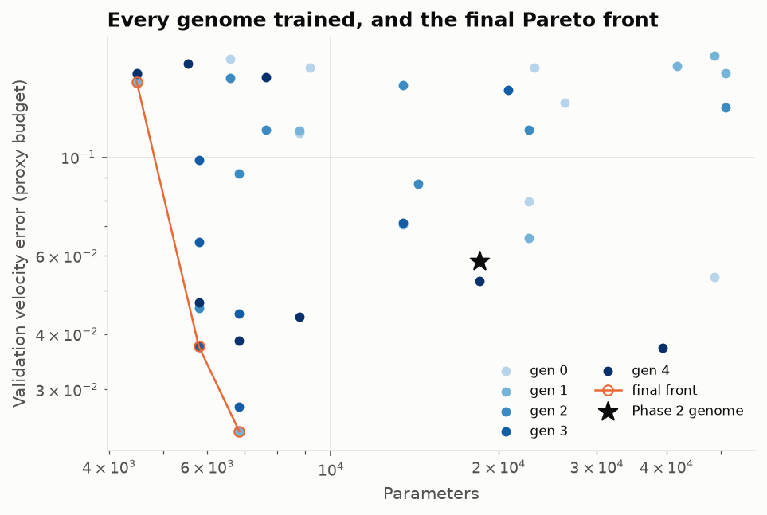
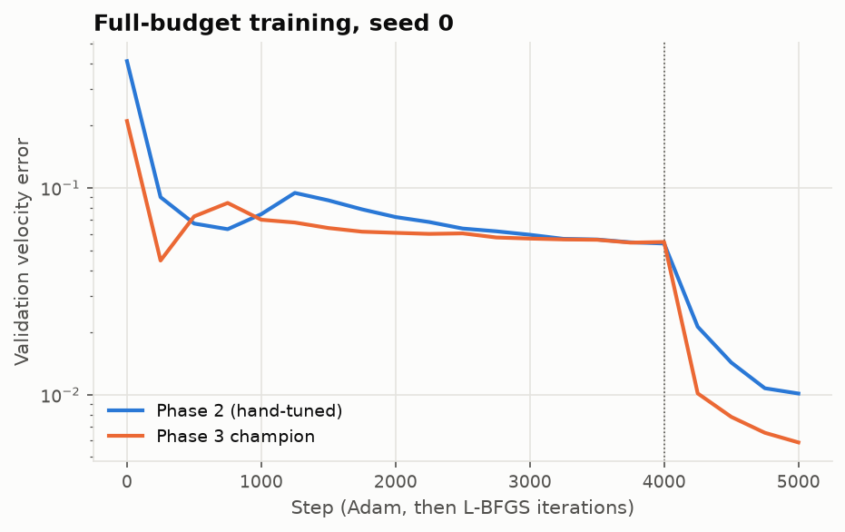

# Lesson 3 · Neuroevolution for PINN architecture and loss weighting

> Lesson 2's network has a dozen numbers nobody derived: depth, width, activation, learning
> rate, collocation count, and five loss weights. They were set by hand, after nine failures.
> Here a genetic algorithm sets them instead, trading accuracy against network size, and finds
> a network with about a third of the parameters and a third less error. This lesson covers how that
> search works, what it costs, and how far a cheap proxy can be trusted.

**Code:** [`src/pinncfd/neuroevolution_search/`](../../src/pinncfd/neuroevolution_search/) ·
**Results:** [`validation/results/neuroevolution.md`](../../validation/results/neuroevolution.md) ·
**Notebook:** [`03_neuroevolution.ipynb`](../../notebooks/03_neuroevolution.ipynb) ·
**Previous:** [Lesson 2](02-airfoil-flow-fields.md) · **Next:** [Lesson 4](04-surrogates-in-a-design-loop.md)

## Learning objectives

1. Write a PINN's hyperparameters and loss weights as a genome, and say why a flat genome keeps
   crossover and mutation simple.
2. Define Pareto dominance, and explain NSGA-II's non-dominated sorting and crowding distance.
3. Use a short proxy budget to rank genomes, and know what it can and cannot tell you.
4. Read a search's results critically: noise from one seed per genome, genes that travel
   together by descent, and transient dips in the error history.
5. Account for what a search costs, and explain why training time follows depth rather than
   parameter count on a small GPU network.

---

## 1. What there is to tune

The Phase 2 loss is a weighted sum. The PDE residual keeps weight 1, since only the ratios
matter:

```math
\mathcal L = \mathcal L_{\text{pde}} + \lambda_{\text{body}}\mathcal L_{\text{body}}
 + \lambda_{\text{tan}}\mathcal L_{\text{tangency}} + \lambda_{\text{kutta}}\mathcal L_{\text{kutta}}
 + \lambda_{\text{far}}\mathcal L_{\text{far}} + \lambda_{\text{data}}\mathcal L_{\text{data}}
```

The genome holds twelve genes, each with its own domain and sampling rule
([`genome.py`](../../src/pinncfd/neuroevolution_search/genome.py)):

| Gene | Domain | Sampling | Phase 2 value |
|---|---|---|---|
| depth | 3, 4, 5, 6 | choice | 5 |
| width | 32, 48, 64, 96 | choice | 64 |
| activation | tanh, sin, SiLU | choice | tanh |
| Fourier features | 0, 16, 32 | choice | 0 |
| Fourier scale | 0.25–2 | uniform | — |
| interior points per shape | 192, 384, 768 | choice | 384 |
| Adam learning rate | 3e-4 – 3e-3 | log-uniform | 1e-3 |
| $\lambda$ body, tangency, Kutta, far field, data | 0.1–100 each | log-uniform | 10, 1, 10, 10, 10 |

Weights are drawn log-uniform because their effect is multiplicative: 0.1 → 1 matters as much
as 10 → 100. The genome is *flat*: twelve independent genes of fixed length, as in the RUL
project this code is ported from. A variable-length genome (one entry per layer, as in NEAT;
Stanley & Miikkulainen 2002) can express more architectures but needs crossover rules that
align layers. Here every MLP is a depth and a width, so the flat form loses nothing.

Two operators make new genomes:

- **Uniform crossover:** each gene comes from one parent or the other, with equal probability.
- **Mutation:** each gene is redrawn from its domain with probability 0.2.

Both keep every gene inside its domain by construction. `tests/test_neuroevolution.py` checks
this over thousands of draws.

## 2. Two objectives: accuracy and size

A smaller network is cheaper to evaluate, and Lesson 4 uses the network as a surrogate, so size
matters as much as accuracy. The search therefore minimises two objectives for each genome $g$:
the validation velocity error $e(g)$ and the parameter count $n(g)$. Neither single ranking is
right, so the search keeps the **Pareto front**: genome $a$ *dominates* $b$ when it is no worse
on every objective and better on at least one,

```math
a \prec b \iff f_k(a) \le f_k(b) \ \text{for all } k \ \text{ and } \ f_k(a) < f_k(b) \ \text{for some } k,
```

and the front is the set of genomes nothing dominates. Every point on it is a defensible
choice; the user picks one by how much a percent of error is worth in parameters.

**NSGA-II** (Deb, Pratap, Agarwal & Meyarivan 2002) evolves a population towards that front:

1. **Non-dominated sorting.** Peel the population into fronts: front 0 is the non-dominated
   set, front 1 is what is non-dominated once front 0 is removed, and so on. A genome's *rank*
   is its front.
2. **Crowding distance.** Within a front, sort by each objective and add up the normalised gap
   between each genome's two neighbours:

   ```math
   d_j = \sum_k \frac{f_k(j^{+}) - f_k(j^{-})}{f_k^{\max} - f_k^{\min}},
   ```

   where $j^{+}$ and $j^{-}$ are the neighbours of $j$ when the front is sorted by objective $k$.
   The two ends of the front get $d = \infty$. A large $d$ means the genome sits in a sparse
   part of the front.
3. **Parents** come from binary tournaments: draw two genomes, keep the lower rank, and break
   ties by the larger crowding distance.
4. **Survivors.** Parents and children are pooled and the best `population_size` are kept by
   rank. The last front that only partly fits is cut by crowding distance, so the front stays
   spread out instead of collapsing onto one corner.

Step 4 is elitist: a genome on the front survives until something dominates it. So the
search never loses its best network.

The run used a population of 8 and 5 generations: 8 genomes in generation 0, and 8 children in
each later generation, so 40 genomes were trained. Generation 0 is the hand-tuned Phase 2
genome plus seven random ones. Seeding with the manual choice means the search starts no worse
than Lesson 2 did.

## 3. The proxy budget

The Phase 2 budget, 4000 Adam steps plus 1000 L-BFGS iterations, takes about ten minutes per
network. Forty of those would take nearly seven hours. Each genome is therefore trained on a
**proxy budget** of 400 Adam steps and 100 L-BFGS iterations, about a minute on the RTX 2060
capped at 1000 MHz. Its validation error at that point is its fitness. This is a
*multi-fidelity* search in its simplest form. Successive halving and Hyperband (Li et al.
2018) refine the idea by promoting good genomes to longer budgets.

The proxy assumes that a genome which is ahead after 500 steps is still ahead after 5000. It is
an assumption, and it can fail in two ways:

- **Slow starters lose.** A small learning rate or a large network may be behind early and
  ahead late. The proxy is biased against them.
- **Early leaders can stall.** A configuration that drops fast and then plateaus looks better
  than it is.

The champion in Section 5 is therefore retrained at the full budget over three seeds before
any claim is made. Section 5 also reports that its lead shrank at full budget.

## 4. What the search found

| Generation | Best error | Median error | Parameters (min–max) | Front size | Genomes trained |
|---|---|---|---|---|---|
| 0 | 0.0537 | 0.123 | 6595–48707 | 4 | 8 |
| 1 | 0.0241 | 0.0682 | 4483–48707 | 2 | 16 |
| 2 | 0.0241 | 0.0644 | 4483–48707 | 3 | 24 |
| 3 | 0.0241 | 0.0451 | 4483–6851 | 3 | 32 |
| 4 | 0.0241 | 0.0416 | 4483–39395 | 3 | 40 |

At the proxy budget the hand-tuned genome scored 0.0583 with 18,499 parameters. The best genome
appeared in generation 1 and was never beaten. After that the population caught up with it: the
median error fell from 0.123 to 0.042.



The final front has three genomes:

| Error (proxy) | Parameters | Genome |
|---|---|---|
| 0.0241 | 6,851 | 6×32 SiLU, lr 1.4e-3, 192 points; λ body/tan/Kutta/far/data = 5.4/6.6/15/3.2/64 |
| 0.0375 | 5,795 | 5×32 tanh, lr 3.2e-4, 384 points; λ = 43/0.15/1.0/0.28/9.1 |
| 0.148 | 4,483 | 3×32 tanh, 16 Fourier features, lr 3.2e-4, 192 points; λ = 29/0.15/1.0/1.2/9.1 |

The 40 genomes also show some patterns, read with care:

- **Fourier features hurt.** All 14 genomes with them scored 0.115 or worse. Of the 26
  without them, the median error was 0.065. In this code the features *replace* the inputs,
  including the Joukowski coordinates and the case parameters, with sines and cosines of random
  projections. Fourier features help a network represent high frequencies (Tancik et al.
  2020), but this flow is smooth in the conformal coordinates, so they mostly add oscillation.
  That explanation is a hypothesis; the search only shows the effect.
- **Sine is the weakest activation:** median 0.115, against 0.071 for tanh and 0.079 for SiLU.
- **Depth beats width.** No depth-3 genome came below 0.13, and the four best were depth 5 or
  6. Width 32 was enough; the front holds only width-32 networks.
- **The data weight matters most.** Among the genomes without Fourier features, the rank
  correlation with error is −0.49 for $\lambda_{\text{data}}$ (more data weight, less error)
  and +0.47 for $\lambda_{\text{far}}$. The champion weights data 64, against 10 by hand.

These correlations are not controlled experiments. The genes travel together by descent:
children share their parents' genes, so the late generations hold many close relatives, and a
gene that rides with a good one looks good too. Each genome was also trained with one seed. In
Phase 2, three seeds of the same configuration gave errors from 0.98 % to 1.51 %. The gap
between the two best genomes, 0.024 against 0.027, is within that kind of noise. A
correlation from this search is a lead to test, not a finding.

## 5. The champion at the full budget

The champion is the front's most accurate genome: 6×32 SiLU, 6,851 parameters. It was
retrained with the full Phase 2 budget on seeds 0, 1 and 2. Both models were then evaluated on
the test set (6 sections × 4 angles), which the search never saw:

| Model | Parameters | Val velocity error | Test velocity error | Test Cp RMS | Test cl error (circulation) | Training time |
|---|---|---|---|---|---|---|
| Phase 2, hand-tuned | 18,499 | 1.17 % ± 0.3 % | 1.16 % | 0.116 | 0.121 | 575 ± 30 s |
| Phase 3 champion | 6,851 | 0.72 % ± 0.11 % | 0.78 % ± 0.17 % | 0.094 ± 0.016 | 0.037 ± 0.005 | 653 ± 5.5 s |

Test columns are means over the seeds whose networks were saved: all three for the champion,
seed 0 only for Phase 2.

The champion wins on every accuracy measure, and by most on lift. Phase 2's main weakness, a
lift slope about 20 % low, was largely a weighting problem: with the data term weighted 64
instead of 10, the circulation error falls from 0.12 to 0.037. That is consistent with Lesson
2's diagnosis that physics under-predicts lift and data fixes it.

The proxy overstated the gain. At the proxy budget the champion's error was 2.4 times lower
than the hand-tuned genome's; at the full budget it is 1.6 times lower. The ranking held for
the two genomes compared at both budgets. Two genomes are too few to measure how well the
proxy ranks in general.



Both curves are almost flat through the second half of Adam and drop sharply once L-BFGS
starts at step 4000. Neither had plateaued at step 5000.

## 6. Compute budget

| Item | Value |
|---|---|
| Proxy training per genome | 54–84 s, mean 60 s |
| Search: 40 genomes | 40.1 min |
| Champion retraining: 3 seeds × 5000 steps | 3 × 653 s = 32.7 min |
| **Total, Phase 3** | **≈ 73 min** on the RTX 2060 at 1000 MHz |
| Champion: steps to 1e-2 | 4500, 4500, 4750: all in L-BFGS, after 500–750 iterations |
| Champion: time to 1e-2 | 580–610 s |
| Phase 2: steps to 1e-2 | 5000 for one seed in three; the other two never reached it |
| Plateau (1 % per 1000 steps) | not reached by either model within 5000 steps |

The champion's steps to 3e-2 range from 500 to 4250. The 500 is a transient: early in Adam
the error of seed 1 dipped below 3 % and then rose again, as seed 0's curve does in the figure.
"First step below the target" counts such dips, so the 1e-2 column is the robust one here.

The champion has about a third of the parameters and half the interior collocation points, yet
it trains 13 % *slower*. Across the 40 genomes, the rank correlation of training time is 0.70
with depth and only 0.35 with parameter count. A network this small does not fill the GPU:
the cost of a step is set by how many small kernels run in sequence, and that grows with the
length of the autograd graph, which grows with depth, not with the matrix sizes. Much of each
step does not depend on the MLP at all (the Joukowski map, six loss terms, resampling), so the
effect is real but modest: 3×96 SiLU trained in 54.5 s, 6×32 SiLU in 64.5 s.

## 7. Common pitfalls

- **Trusting the proxy.** Retrain the winner at the real budget, over several seeds, before
  quoting it.
- **One seed per genome.** Rankings within the seed spread are noise. A larger population or
  re-evaluating the front over seeds is the remedy, at a cost.
- **Reading correlations as effects.** Genes are correlated by descent. To test one gene,
  vary it alone around a fixed genome.
- **Evaluating on the validation set used for fitness.** The search optimised validation error,
  so its validation score is optimistic. Only the test set, untouched until the end, gives an
  unbiased comparison.
- **Counting parameters as cost.** On a GPU at this size, wall time follows depth. If inference
  time is the real objective, measure it as the objective.
- **Searching too wide a box.** A gene that never helps, like Fourier features here, wastes a
  third of the evaluations. Narrow the box after a first search.

## 8. Exercises

1. Three genomes have (error, parameters) = (0.03, 6000), (0.02, 9000) and (0.03, 8000). Which
   are on the Pareto front, and why?
2. Why do the ends of a front get infinite crowding distance? What would go wrong without
   that?
3. Section 3 says a proxy is biased against slow starters. Which gene in this genome would you
   expect to suffer most from that bias, and how could you check?
4. A 3×96 SiLU network has three times the parameters of the 6×32 SiLU champion, yet trained
   in 54.5 s against 64.5 s at the proxy budget. Why is the deeper network slower, and why
   only by 18 % rather than twice?
5. Design an experiment that tests whether the data weight, alone, explains the champion's
   lift improvement.

<details>
<summary>Answers</summary>

1. (0.03, 6000) and (0.02, 9000). (0.03, 8000) is dominated by (0.03, 6000): equal error, more
   parameters. The other two each win on one objective.
2. The ends hold the best value of some objective. Infinite distance keeps them whenever their
   front is truncated, so the front keeps its full extent. Without it, truncation could drop
   the most accurate or the smallest network.
3. The learning rate: a small one is behind at step 500 and may catch up by step 5000. Check
   by training a few genomes that differ only in learning rate at both budgets, and comparing
   the rankings.
4. At this size each layer costs about the same few small kernels whatever its width, so time
   per step grows with depth: the 6-layer network runs about twice as many network kernels
   as the 3-layer one. But the network is only part of a step: the Joukowski features, the six
   loss terms, the optimiser and resampling cost the same for both, which dilutes the factor
   of two to 1.18. The search file `phase3_search.json` holds `time_s` and the genome of every
   run.
5. Train the Phase 2 genome with only $\lambda_{\text{data}}$ changed to 64, and the champion
   with only $\lambda_{\text{data}}$ changed to 10, each over three seeds. Compare the
   circulation-lift errors.

</details>

## Key takeaways

- A flat genome of architecture, optimiser and loss-weight genes turns PINN tuning into a
  search that a 200-line NSGA-II can run.
- Two objectives give a front instead of a winner. The front's accurate end beat the
  hand-tuned network at full budget: 0.78 % against 1.16 % test error, with about a third of
  the parameters.
- The largest single gain was lift. A data weight of 64 instead of 10 cut the circulation-lift
  error from 0.12 to 0.037.
- The search took 73 GPU-minutes in all. Its proxy overstated the champion's advantage, and
  its correlations are leads to test, not findings.

## Further reading

- K. Deb, A. Pratap, S. Agarwal & T. Meyarivan, "A fast and elitist multiobjective genetic
  algorithm: NSGA-II", *IEEE Trans. Evol. Comput.* 6, 2002.
- K. O. Stanley & R. Miikkulainen, "Evolving neural networks through augmenting topologies",
  *Evol. Comput.* 10, 2002.
- E. Real, A. Aggarwal, Y. Huang & Q. V. Le, "Regularized evolution for image classifier
  architecture search", *AAAI* 2019.
- T. Elsken, J. H. Metzen & F. Hutter, "Neural architecture search: a survey", *JMLR* 20, 2019.
- L. Li, K. Jamieson, G. DeSalvo, A. Rostamizadeh & A. Talwalkar, "Hyperband: a novel
  bandit-based approach to hyperparameter optimization", *JMLR* 18, 2018.
- M. Tancik et al., "Fourier features let networks learn high frequency functions in low
  dimensional domains", *NeurIPS* 2020.
- S. Wang, Y. Teng & P. Perdikaris, *SIAM J. Sci. Comput.* 43, 2021 (loss balancing by
  gradient statistics, the non-evolutionary alternative).
