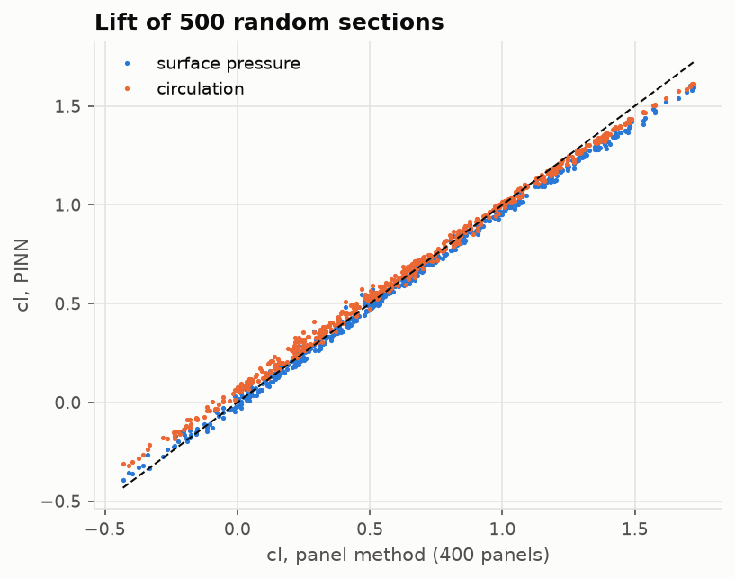
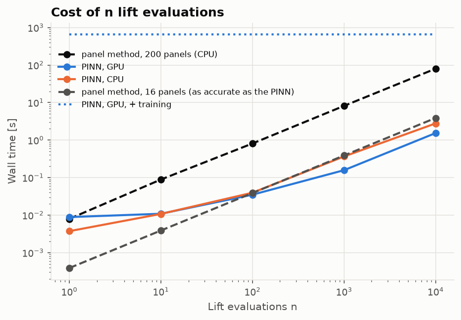
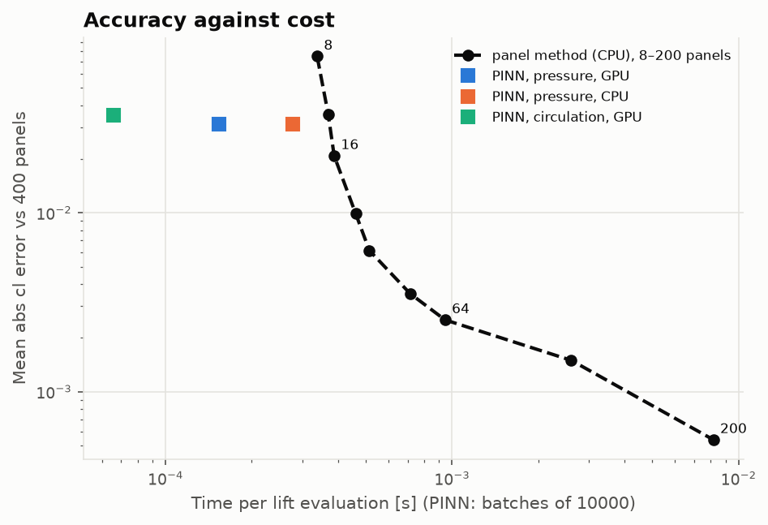
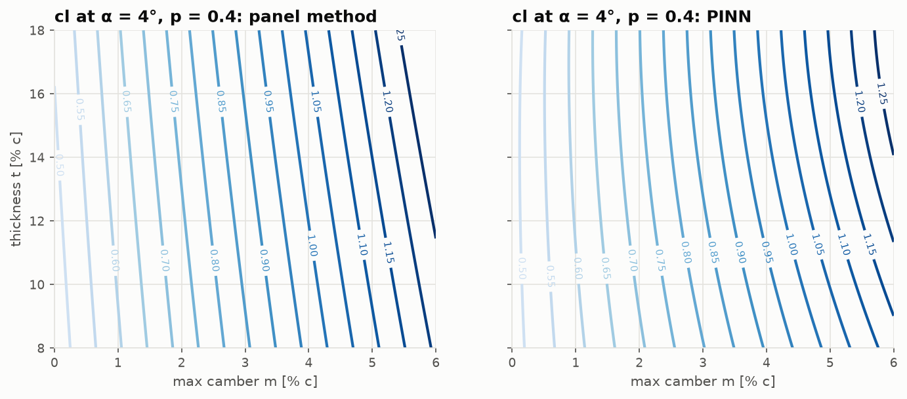

# Lesson 4 · PINNs as surrogates in a design loop

> A trained network answers ten thousand lift queries in a second and a half: fifty times
> faster than the panel method it learned from. That number is true, and it misleads. The
> network is also sixty times less accurate. A 16-panel solve matches its accuracy and costs
> 0.4 ms, and against that the speed-up shrinks to 2.5×. This lesson builds the surrogate,
> times it carefully, and shows how to compare it fairly.

**Code:** [`src/pinncfd/surrogate.py`](../../src/pinncfd/surrogate.py),
[`validation/surrogate_benchmark.py`](../../validation/surrogate_benchmark.py) ·
**Results:** [`validation/results/surrogate_benchmark.md`](../../validation/results/surrogate_benchmark.md) ·
**Notebook:** [`04_surrogate_benchmark.ipynb`](../../notebooks/04_surrogate_benchmark.ipynb) ·
**Previous:** [Lesson 3](03-neuroevolution.md) · **Next:** [Lesson 5](05-toward-compressible-flow.md)

## Learning objectives

1. Turn a trained flow-field PINN into a batched function that returns the lift of many
   sections at once.
2. Write the cost model of a surrogate, and compute its break-even number of evaluations.
3. Time GPU code correctly: warm-up, synchronisation, and every step of the pipeline.
4. Compare a surrogate with a baseline *at equal accuracy*, and explain why that changes the
   answer by an order of magnitude.
5. Use the network's input derivatives to solve an inverse design problem by Newton's method.

---

## 1. What a surrogate has to beat

A surrogate replaces an expensive model with a cheap approximation (Queipo et al. 2005;
Forrester, Sóbester & Keane 2008). Its cost is paid up front. If training takes
$T_{\text{train}}$ and each evaluation $t_{\text{PINN}}$, while the solver it replaces takes
$t_{\text{solver}}$ per evaluation, then $n$ evaluations cost

```math
T_{\text{PINN}}(n) = T_{\text{train}} + n\, t_{\text{PINN}},
\qquad
T_{\text{solver}}(n) = n\, t_{\text{solver}},
```

and the surrogate pays off beyond the break-even count

```math
n^{*} = \frac{T_{\text{train}}}{t_{\text{solver}} - t_{\text{PINN}}}.
```

Three things decide $n^{*}$: the training time, which includes any search that produced the
network; the per-case speed-up; and *which* solver is the reference. Section 5 shows that the
third matters most.

The surrogate here is the Phase 3 champion, seed 0: 6,851 parameters, trained in 657 s on the
RTX 2060 capped at 1000 MHz, after a 40-minute architecture search. It was chosen over the
Phase 2 network on *validation* error. The test set never enters model selection.

## 2. Lift from a network, in batches

A panel method answers one (shape, incidence) at a time: build the contour, assemble an
$N \times N$ influence matrix, solve it. A PINN answers any number of cases with one forward
and one backward pass. [`pinncfd.surrogate`](../../src/pinncfd/surrogate.py) gets lift from it
in the two ways Lesson 2 validated:

- **Pressure lift** (`cl_pressure`). The network's velocity at the control points of a
  120-panel contour of each section gives $C_p = 1 - |\mathbf V|^2$. That is integrated as
  $-\sum C_p \mathbf n \Delta s$ and rotated to the wind, the same integral the panel method
  uses for its own pressure lift. A test feeds it the panel method's own surface velocities and
  recovers AERO-01's pressure lift to $10^{-6}$.
- **Circulation lift** (`cl_circulation`). $c_l = 2\Gamma$ (Kutta–Joukowski, chord 1,
  $V_\infty = 1$), with $\Gamma$ the circulation of the predicted velocity on a circle of
  radius 1.5 around the section. It needs no contour at all.

Every point of every case goes into one tensor, which the network processes in chunks of tens
of thousands of points.

## 3. Accuracy first

Lift of 500 random sections of the family, against a 400-panel solution:

| Method | Mean abs cl error | 95th percentile | Max |
|---|---|---|---|
| Panel method, 200 panels | 0.00054 | 0.0012 | 0.0015 |
| PINN, surface pressure | 0.031 | 0.080 | 0.137 |
| PINN, circulation | 0.035 | 0.088 | 0.121 |



The PINN tracks the panel method across the whole range but falls slightly short at high lift.
This is what is left of Lesson 2's low lift slope, which Lesson 3's re-weighting mostly
removed. An error of 0.03 in $c_l$ is about 0.3° of incidence. It is good enough for a carpet
plot or an early design sweep, and not good enough to size a wing.

## 4. Speed

Wall time for $n$ lift evaluations. The panel method runs one case at a time on the CPU; the
PINN runs one batch on the GPU or the CPU:

| n | Panel, 200 panels | PINN, GPU, pressure | PINN, GPU, circulation | PINN, CPU, pressure | Contours alone | Speed-up, GPU |
|---|---|---|---|---|---|---|
| 1 | 7.9 ms | 8.9 ms | 8.7 ms | 3.7 ms | 0.16 ms | 0.9× |
| 10 | 89 ms | 11 ms | 8.9 ms | 11 ms | 1.8 ms | 8.2× |
| 100 | 0.81 s | 35 ms | 8.4 ms | 40 ms | 13 ms | 23× |
| 1000 | 8.2 s | 0.16 s | 71 ms | 0.37 s | 0.13 s | 52× |
| 10000 | 80 s | 1.54 s | 0.66 s | 2.78 s | 1.31 s | 52× |

The panel times above 1000 cases are the 1000-case time scaled, since the method is strictly
sequential.



Three things in this table are easy to get wrong:

- **One query is not faster.** At $n = 1$ the GPU takes 8.9 ms, as long as a 200-panel solve.
  The time goes mostly to launching many small kernels; the arithmetic is negligible. The
  CPU is faster here (3.7 ms). A GPU surrogate pays only in batches.
- **The network is not the bottleneck.** At $n = 10^4$, building the 120-panel contours in
  NumPy takes 1.31 s of the 1.54 s. The network itself costs about 23 µs per case. The
  circulation lift needs no contour, so it is 2.3 times faster. Time the whole pipeline, not
  only the forward pass.
- **GPU timing needs care.** CUDA calls return before the work is done. Every timing here
  synchronises the device before reading the clock and takes the median of up to three runs
  after a warm-up call. Without the warm-up, the first call also pays for kernel compilation and
  memory allocation.

Against the 200-panel solver, the break-even count is

```math
n^{*} = \frac{657\ \text{s}}{7.99\ \text{ms} - 0.154\ \text{ms}} \approx 84{,}000 \ \text{evaluations},
```

or 391,000 if the 40-minute search that found the network is charged too.

## 5. The equal-accuracy baseline

The comparison in Section 4 is unfair to the panel method. It asks the solver for four
significant figures, then compares it with a surrogate that delivers about two. The fair
reference is the *cheapest panel method that is at least as accurate as the PINN*. The
benchmark sweeps the panel count on the same 500 sections:

| Panels | Mean abs cl error | 95th percentile | Time per case |
|---|---|---|---|
| 8 | 0.075 | 0.15 | 0.34 ms |
| 12 | 0.036 | 0.076 | 0.36 ms |
| **16** | **0.021** | **0.046** | **0.39 ms** |
| 24 | 0.0099 | 0.024 | 0.46 ms |
| 32 | 0.0062 | 0.015 | 0.51 ms |
| 64 | 0.0025 | 0.0053 | 0.95 ms |
| 200 | 0.00054 | 0.0012 | 8.4 ms |

Sixteen panels are already more accurate than the PINN, at 0.39 ms per case. Against that:

| | PINN, pressure (GPU) | PINN, circulation (GPU) |
|---|---|---|
| Speed-up per case | 2.5× | 5.9× |
| Break-even, training charged | 2.8 million evaluations | 2.0 million evaluations |



The figure tells the whole story. The panel method traces a curve of accuracy against cost.
The PINN's points sit to the left of that curve, so it is faster at its accuracy, but only by a
small factor. That small gain has to repay ten minutes of training. Two remarks keep this in
proportion:

- Below about 30 panels, the panel method's time is mostly fixed overhead: 0.34 ms for 8
  panels, 0.39 ms for 16. That overhead is Python, building the contour and setting up the
  solve. A compiled or batched panel code would cut it, and the PINN's case would get weaker
  still. This was not measured here.
- A 2D panel method is about the cheapest solver there is. A surrogate pays off where the
  solver is expensive, such as RANS, 3D or unsteady flow, and where it is queried millions of
  times, as in optimisation, uncertainty quantification or real-time use. This benchmark
  shows the method on a case where it barely can.

## 6. Two design loops

### (a) The incidence for a target lift

Find, for each of the six test sections, the $\alpha$ at which $c_l = 0.8$:

- **Panel method:** Brent's method (bracketing, superlinear) on $[-10°, 15°]$, one section at a
  time. Six 200-panel solves per section, 0.27 s for all six.
- **PINN:** Newton's method on all six sections at once (`solve_alpha`). The network is
  differentiable in its inputs, so autograd gives $\partial c_l/\partial\alpha$ through the
  $\alpha$ input with the same backward pass:

  ```math
  \alpha_{k+1} = \alpha_k - \frac{c_l(\alpha_k) - 0.8}{\partial c_l / \partial \alpha \,(\alpha_k)} .
  ```

  From $\alpha = 0$ it converged in 4 batched evaluations, 0.064 s for all six.

| Section | α panel | α PINN | cl (panel) at α PINN |
|---|---|---|---|
| NACA 0012 | 6.620° | 6.673° | 0.806 |
| NACA 1408 | 5.771° | 5.936° | 0.819 |
| NACA 2412 | 4.473° | 4.660° | 0.823 |
| NACA 3315 | 3.442° | 3.500° | 0.807 |
| NACA 4415 | 2.142° | 2.318° | 0.822 |
| NACA 5518 | 0.391° | 0.796° | 0.851 |

The PINN's incidence is within 0.06–0.4° of the panel method's. Checked with a panel solve,
its lift is 0.81–0.85 instead of 0.80. The worst case is NACA 5518, at the corner of the box,
with high camber and the thickest section. A brute-force sweep of 321 incidences per section
gives the same angles to three decimals, but takes 0.29 s. Newton with exact derivatives is
the efficient way to use a differentiable surrogate. At equal accuracy, however, Brent on a
16-panel solver would need about 6 × 6 × 0.39 ms ≈ 14 ms, faster than either.

### (b) A carpet over camber and thickness

The lift of 41 × 41 sections at $\alpha = 4°$ ($p = 0.4$) takes 13.7 s with 200 panels and
0.26 s with the PINN, 53× faster. The mean difference is 0.030 and the maximum 0.082.



The PINN's carpet has the right shape: lift grows with camber and slightly with thickness.
Its values run about 0.03 low, and its contours bend at low thickness, where the panel
method's are nearly straight. For choosing a region of the design space, that is enough. For
the final number, the solver is still needed.

## 7. Compute budget

| Item | Value |
|---|---|
| Surrogate training (Phase 3 champion, seed 0) | 657 s on the RTX 2060 at 1000 MHz |
| Architecture search that produced it | 40.1 min |
| Lift, PINN, GPU, n = 10⁴ | 1.54 s (pressure; 1.31 s of it contours), 0.66 s (circulation) |
| Lift, PINN, CPU, n = 10⁴ | 2.78 s |
| Lift, panel method | 8.0 ms per case (200 panels), 0.39 ms (16 panels) |
| Break-even vs 200 panels | 84,000 evaluations (391,000 with the search) |
| Break-even vs 16 panels (equal accuracy) | 2.8 million (pressure), 2.0 million (circulation) |
| Inverse problem, 6 sections | PINN Newton 0.064 s (4 evaluations); panel Brent 0.27 s (36 solves) |

All rows are in `validation/results/compute_budget.csv` (`phase4`). Training time is charged to
the PINN; evaluation times are medians after a warm-up.

## 8. Common pitfalls

- **An over-accurate baseline.** Compare at equal accuracy, or report both accuracy and time
  side by side.
- **Timing only the network.** Data preparation, here the contours, can dominate.
- **Forgetting the training cost, or the search.** Report $n^{*}$, and say what it includes.
- **Asynchronous GPU timing.** Synchronise before reading the clock, and warm up first.
- **Batch size 1 on a GPU.** Latency, not throughput, decides single queries.
- **Leaving the training box.** The family covers $m \le 0.06$, $t$ from 0.08 to 0.18 and
  $\alpha$ from −4° to 8°. Outside it the surrogate extrapolates without warning: on the
  Phase 2 network's out-of-box sections (NACA 0021, 2406, 8412, and 2412 at 12°) its lift was
  off by 0.04 to 0.37.

## 9. Exercises

1. A solver takes 50 ms per case and a surrogate 0.1 ms, after 2 hours of training. What is the
   break-even count? What if the surrogate must be retrained for every new design family?
2. Why is the GPU slower than the CPU for a single query in Section 4?
3. The pressure lift spends 85 % of its time building contours. Propose two ways to cut that.
4. Newton's method converged in 4 evaluations, Brent's method needed 6 per section. Why does
   that not mean Newton is faster in general?
5. Section 5 finds that 16 panels match the PINN. Would the answer change if the PINN were
   compared on $C_p$ near the trailing edge instead of on $c_l$? Which way?

<details>
<summary>Answers</summary>

1. $n^{*} = 7200 / (0.05 - 0.0001) \approx 144{,}000$. With retraining per family, the
   training is charged to each family's queries: a family queried fewer than 144,000 times is
   cheaper with the solver.
2. A forward and backward pass launches a few hundred small CUDA kernels, each with a fixed
   launch cost of microseconds, plus host–device copies. With one case the arithmetic is tiny,
   so that latency dominates. The CPU runs the same small operations with less overhead.
3. Build the contours once and cache them, as a design loop that varies only $\alpha$ can. Or
   evaluate the NACA thickness and camber formulas in torch on the GPU, batched over sections.
   Or use the circulation lift, which needs no contour.
4. Newton needs a derivative and a good start. Here the derivative came free from autograd
   and $c_l(\alpha)$ is smooth and monotonic. For the panel method a derivative would cost
   extra solves, and Brent's bracket is safer on a non-monotonic curve.
5. Yes: the PINN looks worse. Its trailing-edge $C_p$ errors (Lesson 2) are much larger than
   its lift error, because errors on the two surfaces partly cancel in the lift integral. At
   equal $C_p$ accuracy a coarse panel method wins by more.

</details>

## Key takeaways

- A trained PINN gives batched lift 52× faster than a 200-panel solve, with 0.03 lift error.
- At equal accuracy, against a 16-panel solve, it is only 2.5–5.9× faster, and ten minutes of
  training pay back after 2–3 million evaluations.
- Time the whole pipeline: here the network was 15 % of the PINN's time and contour
  building 85 %.
- Input derivatives make a PINN a good inverse-design tool: Newton found the incidence for a
  target lift on six sections in four batched evaluations.
- Surrogates pay off on expensive solvers queried many times. A 2D panel method is the hardest
  case for them, and the most honest test.

## Further reading

- N. V. Queipo, R. T. Haftka, W. Shyy, T. Goel, R. Vaidyanathan & P. K. Tucker,
  "Surrogate-based analysis and optimization", *Prog. Aerosp. Sci.* 41, 2005.
- A. I. J. Forrester, A. Sóbester & A. J. Keane, *Engineering Design via Surrogate Modelling*,
  Wiley, 2008.
- J. Katz & A. Plotkin, *Low-Speed Aerodynamics*, Ch. 11 (panel methods and their cost).
- M. Drela, "XFOIL: an analysis and design system for low Reynolds number airfoils", 1989 (a
  panel method built for design loops).
- J. Nocedal & S. J. Wright, *Numerical Optimization*, Ch. 11 (Newton's method for equations).
