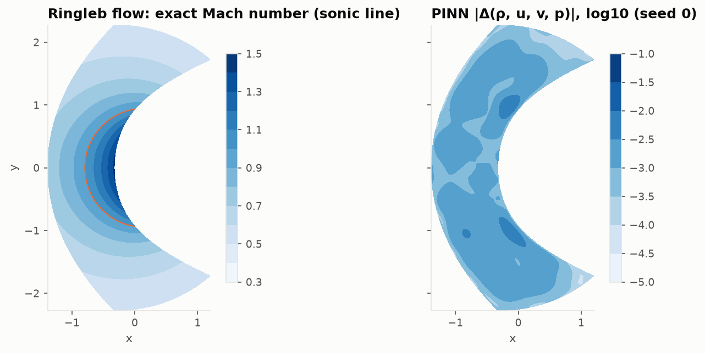
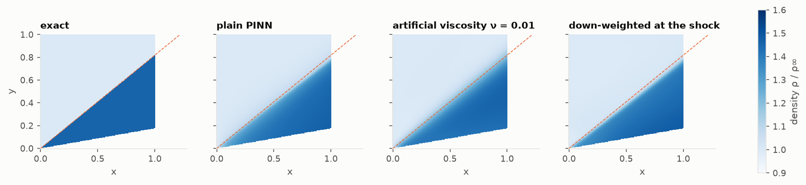
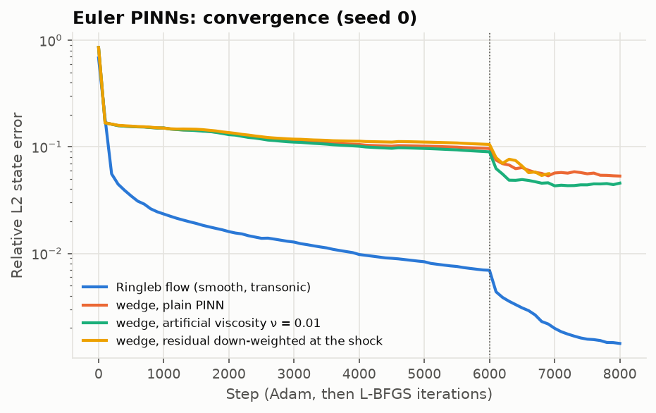

# Lesson 5 · Toward compressible flow, and where PINNs struggle

> Up to now every flow was smooth, and the PINN got within a percent of the reference. This
> lesson takes it to the steady Euler equations. On a smooth transonic flow it does well: 0.14 %
> error. On a supersonic flow with a shock it does not. Three variants all stall near 5 % error
> and smear a sharp jump over a sixth of the domain. This phase was planned as exploratory, and
> the failure, with its evidence, is the result.

**Code:** [`src/pinncfd/pinn_euler_2d/`](../../src/pinncfd/pinn_euler_2d/) ·
**Results:** [`validation/results/euler_exploratory.md`](../../validation/results/euler_exploratory.md) ·
**Notebook:** [`05_euler.ipynb`](../../notebooks/05_euler.ipynb) ·
**Previous:** [Lesson 4](04-surrogates-in-a-design-loop.md) · **Next:** [Lesson 6](06-verification-validation-and-when-to-use-a-pinn.md)

## Learning objectives

1. Write the steady Euler equations in conservation form, and explain why that form matters at
   a shock.
2. Verify a compressible solver against two exact solutions: Ringleb flow and the oblique shock.
3. Set up an Euler PINN that keeps density and pressure positive.
4. Diagnose a PINN that fails on a discontinuity: smearing, misplacement, and where the
   residual sits.
5. Judge which fixes address the cause, and which only move the error.

---

## 1. A different kind of problem

Laplace's equation is elliptic: every point feels every boundary, and the solution is smooth
inside the domain. That suits a network, which is itself a smooth function. The steady Euler
equations in supersonic flow are hyperbolic. Information travels along characteristics, and
where characteristics converge they produce a **shock**: a jump in density, velocity and
pressure across a layer a few mean free paths thick, which is zero thickness at this scale.

A jump has no derivative, so the differential equations do not hold at it. What holds is the
integral form, conservation of mass, momentum and energy through any control volume. Its
*weak solutions* include shocks, with jumps fixed by the Rankine–Hugoniot conditions. This is
why the residual is written in conservation form:

```math
\frac{\partial \mathbf F(\mathbf U)}{\partial x} + \frac{\partial \mathbf G(\mathbf U)}{\partial y} = 0,
\qquad
\mathbf U = (\rho,\ \rho u,\ \rho v,\ E).
```

Written for the primitive variables instead, the equations are equivalent where the flow is
smooth but admit jumps of the wrong strength (LeVeque 2002, Ch. 12). A network trained on the
conservative residual is at least pushed toward the right jump.

The network outputs $(\rho, u, v, p)$. Density and pressure pass through a softplus so they stay
positive: a negative pressure would make the sound speed imaginary, and the energy meaningless.
The fluxes are built from those outputs and differentiated by autograd. Details are in
[docs/pinn_euler_2d.md](../pinn_euler_2d.md).

## 2. Two exact solutions

**Ringleb flow** (Ringleb 1940; Chiocchia 1985) comes from the hodograph method: the solution is
written in the speed $q$ and a streamline label $k$, and mapped back to $(x, y)$. It turns the
flow around the end of a plate. With streamlines $0.7 \le k \le 1.2$ the domain holds a
supersonic pocket next to the inner wall, smooth everywhere, with no shock. The tests check
two things: that it satisfies the Euler equations to $10^{-6}$, by central differences through
the hodograph Jacobian, and that its streamlines are lines of constant $k$.

**The oblique shock on a wedge.** A Mach 2 stream meets a wedge of half-angle 10°. An attached
straight shock at angle $\beta$ turns the flow parallel to the wall. $\beta$ is the weak root
of the $\theta$–$\beta$–$M$ relation, and the jumps follow from the normal Mach number
$M\sin\beta$:

| Quantity | Exact | NACA Report 1135 charts |
|---|---|---|
| Shock angle $\beta$ | 39.31° | 39.3° |
| $p_2/p_1$ | 1.7066 | 1.71 |
| $\rho_2/\rho_1$ | 1.4584 | 1.46 |
| $M_2$ | 1.6405 | 1.64 |

The tests also check that the normal mass, momentum and energy fluxes are continuous across the
shock to $10^{-12}$. Both solutions are verified before any network sees them, so a failure
later is the network's.

## 3. Ringleb flow: a success

A 5 × 64 tanh network, 8192 interior points, exact data on the whole boundary, 6000 Adam steps
then 2000 L-BFGS iterations:

| | Seed 0 | Seed 1 |
|---|---|---|
| State error, relative L2 of $(\rho, u, v, p)$ | 1.43e-3 | 1.43e-3 |
| Density error | 1.1e-3 | 0.8e-3 |
| Pressure error | 0.7e-3 | 0.5e-3 |
| Steps to 1e-2 | 4000 | 2900 |
| Training time | 421 s | 420 s |



The error is spread evenly, around $10^{-3}$, with no concentration at the sonic line. The
supersonic pocket costs the network nothing, because the flow there is smooth. The error kept
falling until the last few hundred steps, as in every smooth case in this course.

## 4. The wedge: three ways to miss a shock

Same network and budget, on $[0, 1]^2$ above the wedge. The freestream is imposed at the inflow
and on the top, slip on the wall, and nothing on the supersonic outflow. Three variants:

1. **Plain:** the conservative residual as it is.
2. **Artificial viscosity:** add $\nu\nabla^2\mathbf U$ with $\nu = 0.01$. The exact
   solution of the viscous equations has a smooth shock of width about
   $\nu/\Delta u_n \approx 0.025$, which a smooth network can represent in principle.
3. **Down-weighted at the shock:** multiply the residual by $1/(1 + |\nabla\cdot\mathbf v|)$, a
   simplified form of the weighted-equations idea of Liu et al. (2024). The residual at a
   shock is huge and says nothing useful about the smooth regions, which it would otherwise
   drown out.

| Variant | State error | Error away from the shock | Shock angle | Steps to 1e-1 | Training time |
|---|---|---|---|---|---|
| Plain | 5.3 % | 3.0 % | 37.5° | 5400 | 448 s |
| Artificial viscosity | 4.6 % | 2.3 % | 38.4° | 4100 | 1336 s |
| Down-weighted | 5.6 % | 2.8 % | 36.9° | 6100 | 580 s |
| *Exact* | — | — | *39.31°* | — | — |

"Away from the shock" excludes a band of ±0.05 around the exact shock. None of the three reached
3 % error. All three plateaued during L-BFGS, between steps 6800 and 7000.





### What the networks got right, and what they did not

The saved networks show three things:

- **The jump strength is roughly right.** Behind the shock, at (0.9, 0.20), the plain PINN has
  $\rho = 1.463$ against 1.458 and $p = 1.212$ against 1.219. The viscous one has
  $\rho = 1.434$, 1.7 % low. The conservation form is doing its job: the states on either side
  approximately satisfy Rankine–Hugoniot.
- **The shock is smeared, far more than the viscosity asks.** Measured normal to the shock, the
  density rises from 10 % to 90 % of its jump over 0.155 (plain), 0.172 (viscous) and 0.132
  (down-weighted). With $\nu = 0.01$ the viscous shock is about 0.025 thick, seven times
  thinner than what the network produced. The width is set by what the network can represent
  within its budget, not by the physics added to the loss.
- **The shock sits too shallow,** by 0.9–2.4°. In the figure the compression fans out from the
  wedge apex instead of starting as a sharp corner. Near the apex the smeared shock and the
  wall meet, so the network rounds the corner, and the error propagates downstream along the
  shock.

Where the residual sits says why training stalls. In the band of ±0.05 around the exact shock,
about a tenth of the domain, the median residual is 9 to 17 times larger than elsewhere. That band
holds 54 % (plain), 72 % (viscous) and 75 % (down-weighted) of the total squared residual. The
optimiser spends most of its effort on a region where a smooth function cannot satisfy the
equations, and the smooth regions get what is left. That is why even the "away from the shock"
error is 2–3 %, against 0.14 % for Ringleb flow.

### Why the fixes did not help much

- **Artificial viscosity** makes the target smooth, but a smooth target 0.025 thick is still too
  sharp for this network at this budget. It improved the error from 5.3 % to 4.6 % and the
  angle by 0.9°, and tripled the training time, because the Laplacian of four fields needs
  second derivatives through the network.
- **Down-weighting the residual at the shock** removed the shock's grip on the loss, but also
  the only signal that places the shock. The network was free to put it anywhere nearby, and
  put it at 36.9°.
- Neither changes the representation. A tanh network is a smooth function, and fitting a jump
  with one is the Gibbs problem in another form. Rahaman et al. (2019) call this preference
  for low frequencies *spectral bias*.

## 5. What would work better

This phase tried the cheap fixes; the literature has heavier ones:

- **Adaptive collocation:** move points into the shock as training proceeds (residual-based
  adaptive refinement; Lu et al. 2021).
- **Domain decomposition:** separate networks on either side of the shock, coupled by flux
  conditions (XPINNs; Jagtap & Karniadakis 2020). The jump then lives at an interface, not
  inside a network.
- **Shock fitting:** make the shock position a trainable parameter and impose
  Rankine–Hugoniot across it explicitly. This is exact, but only for a shock whose topology
  you already know.
- **A classical scheme:** a second-order finite-volume solver with a Riemann solver typically
  captures a shock like this in two or three cells, on a mesh that solves in seconds. This
  project did not run one. For a problem with shocks, that is still the tool to use.

## 6. Compute budget

| Case | Runs | Training time | Steps to 1e-2 | Final error |
|---|---|---|---|---|
| Ringleb flow | 2 | 421 s each | 2900–4000 | 0.14 % |
| Wedge, plain | 1 | 448 s | never (1e-1 at 5400) | 5.3 % |
| Wedge, artificial viscosity | 1 | 1336 s | never (1e-1 at 4100) | 4.6 % |
| Wedge, down-weighted | 1 | 580 s | never (1e-1 at 6100) | 5.6 % |
| **Total, Phase 5** | 5 | **53.4 min** on the RTX 2060 at 1000 MHz | | |

The rows are in `validation/results/compute_budget.csv` (`phase5`).

## 7. Common pitfalls

- **Primitive-variable residuals with shocks.** They accept wrong jumps. Use conservation form.
- **Unbounded density or pressure outputs.** One negative value makes the sound speed and the
  energy meaningless. Constrain them, here with a softplus.
- **Reading a low total error as success.** 5 % state error sounds acceptable. A shock 2° off
  and 0.15 thick does not. Measure the shock itself: position, thickness, jump.
- **Assuming viscosity sets the shock width.** Check it: here the network's own smoothness set
  it, at seven times the viscous scale.
- **Down-weighting without a replacement signal.** A weight that silences the shock also stops
  the network from placing it.

## 8. Exercises

1. Show that a uniform flow satisfies both the conservative and the primitive form of the
   steady Euler equations. Why does that say nothing about which form is right at a shock?
2. For $M = 2$ and $\theta = 10°$, compute the normal Mach number ahead of the shock and the
   normal velocity jump $\Delta u_n$, and from them the viscous shock width for $\nu = 0.01$.
3. Why can the Ringleb PINN have its largest *relative* challenge near the sonic line, and yet
   show no error concentration there?
4. The down-weighted variant placed the shock worse than the plain one. Propose a weight that
   keeps the residual's information about the shock position while limiting its size.
5. A shock-fitting PINN makes $\beta$ a trainable parameter. Which loss terms would it need, and
   what does it give up?

<details>
<summary>Answers</summary>

1. All derivatives vanish, so every residual is zero in either form. The forms differ only in
   how they weight derivatives of products, which matters where the derivatives are infinite:
   at a jump. Smooth test fields cannot tell them apart.
2. $M_{n1} = 2\sin 39.31° = 1.267$; the normal velocity drops by the density ratio, from 1.267
   to $1.267/1.458 = 0.869$ (sound-speed units), so $\Delta u_n \approx 0.40$ and the width
   $\nu/\Delta u_n \approx 0.025$.
3. The sonic line is special for the equations' type, elliptic on one side and hyperbolic on
   the other, but the Ringleb solution is smooth across it. A network sees only the solution's
   smoothness, not the equations' type.
4. Weight by the *expected* residual, for example by normalising each point's residual by a
   running estimate of its local size, so points keep their direction but not their magnitude.
   Or keep the full residual on a coarse set of points that pins the shock position. There are
   other answers; the requirement is that the shock still pulls on its location.
5. Rankine–Hugoniot conditions across the fitted line, two smooth networks on its two sides
   with their own residuals, and the boundary conditions. It gives up generality: the number and
   topology of shocks must be known in advance.

</details>

## Key takeaways

- On smooth compressible flow, transonic included, the Euler PINN behaves like the potential
  flow PINNs: 0.14 % error on Ringleb flow in 7 minutes.
- On a shock it fails in a characteristic way. The jump strength is roughly right, thanks to the
  conservation form, but the shock is smeared over 0.13–0.17 of the domain and placed 1–2°
  too shallow, and the smooth regions are left at 2–3 % error.
- Artificial viscosity and residual down-weighting moved the error by about a percentage point
  at most. The limit is the network's ability to represent a jump, not the loss.
- For flows with shocks, shock-capturing finite-volume schemes remain the right tool. Shock
  handling is the main open problem for PINNs in compressible aerodynamics.

## Further reading

- R. J. LeVeque, *Finite Volume Methods for Hyperbolic Problems*, Cambridge, 2002, Ch. 11–12.
- J. D. Anderson, *Modern Compressible Flow*, 3rd ed., Ch. 4.
- Ames Research Staff, NACA Report 1135, 1953.
- G. Chiocchia, "Exact solutions to transonic and supersonic flows", AGARD AR-211, 1985.
- Z. Mao, A. D. Jagtap & G. E. Karniadakis, "Physics-informed neural networks for high-speed
  flows", *Comput. Methods Appl. Mech. Eng.* 360, 2020.
- A. D. Jagtap & G. E. Karniadakis, "Extended physics-informed neural networks (XPINNs)",
  *Commun. Comput. Phys.* 28, 2020.
- L. Lu, X. Meng, Z. Mao & G. E. Karniadakis, "DeepXDE: a deep learning library for solving
  differential equations", *SIAM Rev.* 63, 2021.
- L. Liu et al., "Discontinuity computing using physics-informed neural networks", *J. Sci.
  Comput.* 98, 2024.
- N. Rahaman et al., "On the spectral bias of neural networks", *ICML* 2019.
