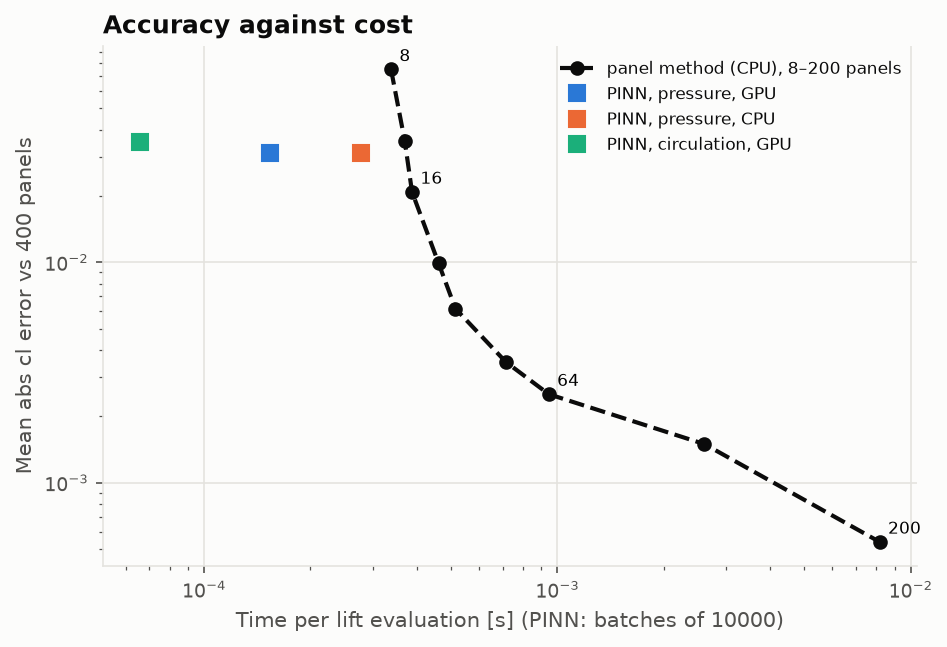
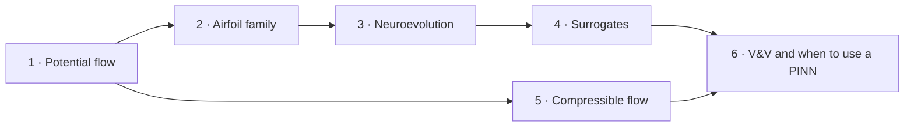

# Physics-informed neural networks for aerodynamics: the course

Six lessons that build, test and judge physics-informed neural networks on aerodynamic flows.
They start from potential flow past a cylinder and end at a supersonic shock the method cannot
capture. Each lesson derives the formulation, shows the code in this repository, measures it
against an exact solution or a panel method, reports what it cost to train, and ends with
exercises (answers included). The failed attempts are part of the material.



## Lessons

| # | Lesson | You will learn | Key result |
|---|---|---|---|
| 1 | [PINNs for potential flow](01-pinns-for-potential-flow.md) | the PINN loss, autograd derivatives, stream function vs potential, soft vs hard boundary conditions | hard constraints: 7.7e-5 error, 1e-2 in 400 steps instead of 5600 |
| 2 | [Learning a family of airfoil flow fields](02-airfoil-flow-fields.md) | parametric PINNs, the Kutta condition, far fields, conformal-map input features | one network for the NACA family, 1.2 % test error, after nine instructive failures |
| 3 | [Neuroevolution for architecture and loss weighting](03-neuroevolution.md) | genomes, Pareto dominance, NSGA-II, proxy budgets and their bias | an evolved network with a third of the parameters and 0.78 % error |
| 4 | [PINNs as surrogates in a design loop](04-surrogates-in-a-design-loop.md) | batched inference, break-even cost, GPU timing, Newton with input gradients | 52× faster than 200 panels, but 2.5× at equal accuracy |
| 5 | [Toward compressible flow](05-toward-compressible-flow.md) | conservation form, Ringleb flow, oblique shocks, why smooth networks miss jumps | 0.14 % on smooth transonic flow; a shock smeared and misplaced |
| 6 | [Verification, validation, and when to use a PINN](06-verification-validation-and-when-to-use-a-pinn.md) | test hierarchies, how a PINN's error differs, honest cost reporting | a decision table backed by the five phases |



Lessons 1 → 2 → 3 → 4 follow the incompressible path, each building on the network before it.
Lesson 5 needs only Lesson 1. Lesson 6 draws on all of them.

## Prerequisites

- Calculus and vector calculus: gradients, the Laplacian, line integrals.
- Potential flow: stream function, uniform flow, doublet and vortex, the Kutta condition
  ([AERO-01's lessons 1–2](https://github.com/GMCavalheri/aerodynamics-from-scratch/tree/main/docs/lessons)
  cover the essentials).
- Neural networks at the level of an MLP trained by gradient descent.
- Enough Python, NumPy and PyTorch to read a 50-line function.

## How to use it

1. **Read the lesson.** The failed attempts are worth reading as closely as the final method.
2. **Run the matching notebook** in [`notebooks/`](../../notebooks). They load the trained
   networks, so nothing needs a GPU.
3. **Open the code** linked at the top of each lesson. The theory notes in [`docs/`](..) give a
   compact summary of each module.
4. **Do the exercises** before opening the answers.

```bash
uv sync --extra cpu
uv run --with jupyterlab jupyter lab notebooks/
```

JupyterLab is not a project dependency; `--with` pulls it in for that command only.

## Compute

Every number in the lessons comes from [`validation/results/`](../../validation/results). Every
training run is in [`compute_budget.csv`](../../validation/results/compute_budget.csv), with its
error, training time per optimiser stage and steps to converge, on an RTX 2060 capped at
1000 MHz. Retraining everything takes about 4–5 GPU-hours:

```bash
uv run python validation/run_all.py
```

The [comparison report](../comparison-report.md) collects all of it in one place.
